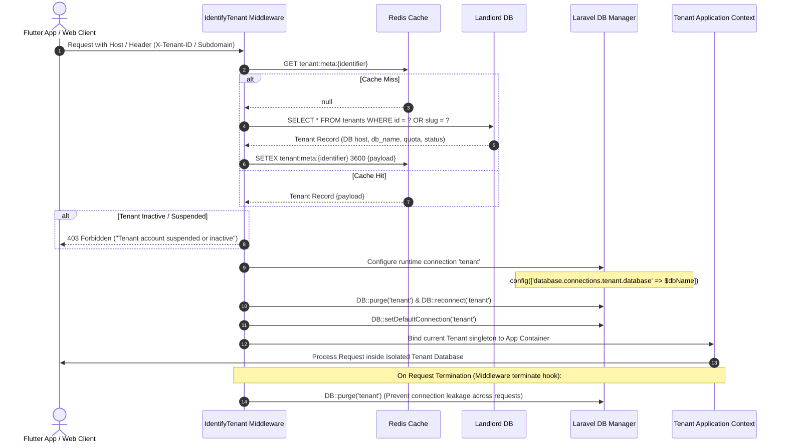
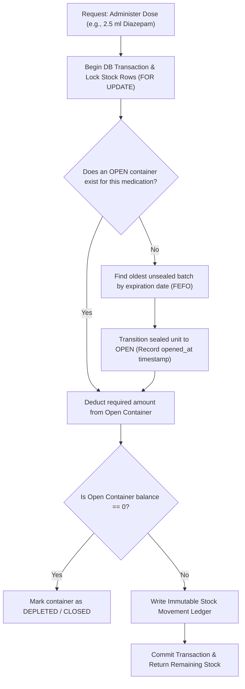
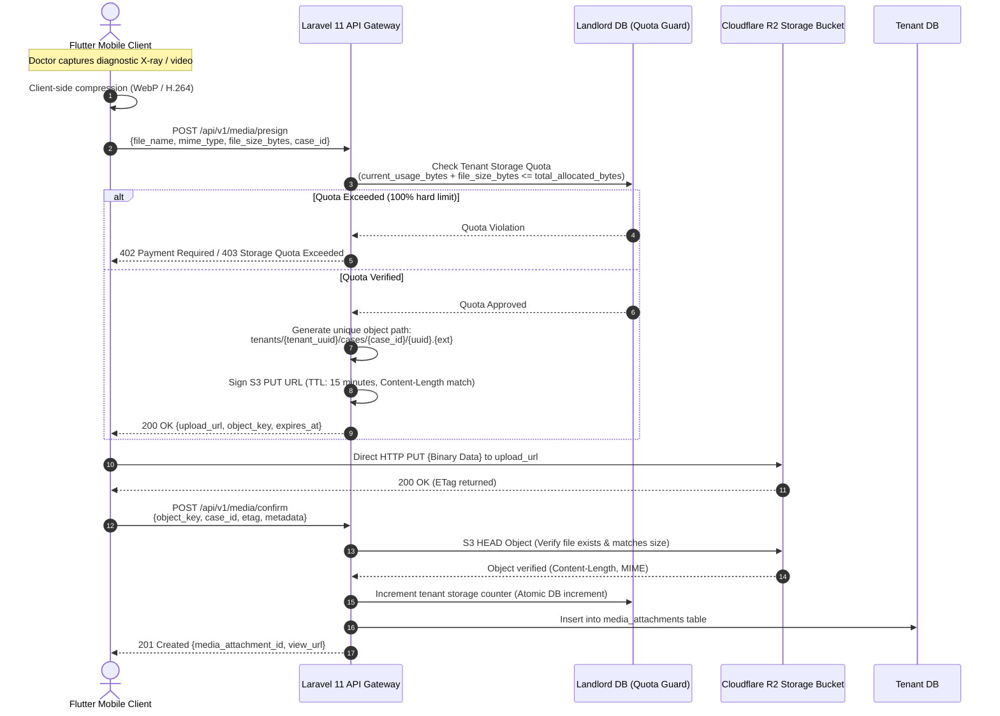

# VetManager: High-Level System Architecture Specification

| Document Metadata | Specification Detail |
| :--- | :--- |
| **System** | VetManager (Multi-Tenant B2B SaaS for Veterinary Clinics & Hospitals) |
| **Status** | Production-Grade Architectural Specification (v1.0.0) |
| **Architect** | Principal Systems Architect & Lead Engineer |
| **Target Framework** | Laravel 11+ (API-First), Flutter 3.x (Mobile), Cloudflare R2, MySQL 8.0, Redis 7.2 |
| **Document Path** | `/docs/ARCHITECTURE.md` |

---

## 1. Executive Summary & Core Architectural Invariants

VetManager is an enterprise-grade, multi-tenant B2B SaaS platform tailored specifically for small animal clinics, companion animal hospitals, and equine/livestock field farm practices. The architecture guarantees high medical precision, zero data cross-contamination between clinics, strict storage cost containment, and role-adaptive field mobility.

### Core Architectural Invariants
1. **Strict Database-Per-Tenant Isolation**: Clinical, patient, medical, and inventory data for each veterinary clinic reside in an autonomous, isolated database schema. No clinic data shares tables with any other clinic.
2. **Base Unit First Principle in Inventory**: All pharmaceuticals and consumables are stored strictly in their smallest indivisible physiological unit (e.g., `ml`, `mg`, `tablet`). Packaging abstractions (vials, boxes, cartons) exist purely as conversion wrappers.
3. **Immutable Clinical Audit Trail**: Daily progress notes, clinical examination logs, and administered dosages cannot be mutated once signed. Corrections are recorded as append-only addenda to safeguard against medical malpractice liability.
4. **Zero-Egress Direct-to-Cloud Media Pipeline**: All clinical media (radiographs, ultrasound clips, macroscopic wound photos) stream directly from the client to Cloudflare R2 via cryptographically signed presigned URLs. The Laravel API server processes zero media bytes in memory.
5. **Dynamic Role-Adaptive Single Client**: A unified Flutter mobile application dynamically adapts navigation hierarchies, permissions, and data payloads based on the authenticated operator (Clinic Owner vs. Field Farm Doctor).

---

## 2. High-Level Architecture Topology

```mermaid
flowchart TB
    subgraph ClientLayer["Client & Field Tier"]
        Flutter["Flutter Mobile App (iOS / Android / Offline Cache)"]
        WebAdmin["Clinic Web Management Console (React / Vue SPA)"]
    end

    subgraph EdgeLayer["Edge & Ingress Tier (Cloudflare)"]
        CF_WAF["Cloudflare WAF / CDN / SSL Termination"]
        R2["Cloudflare R2 Object Storage (Zero Egress Fees)"]
    end

    subgraph GatewayLayer["Application Gateway Tier"]
        Nginx["Nginx Reverse Proxy & Load Balancer"]
        App["Laravel 11 API-First Monolith (PHP 8.3 FPM)"]
        Queue["Laravel Horizon Worker Pool (Queue Management)"]
    end

    subgraph DataLayer["Persistence & Caching Tier"]
        Redis[("Redis 7.2 Cluster: Session, Tenant Meta Cache, Rate Limiting")]
        LandlordDB[("Central / Landlord DB: MySQL 8.0 (Tenants, Plans, Quotas, Global Staff)")]
        subgraph TenantDBs["Tenant Schemas (Database-Per-Tenant)"]
            TDB1[("Tenant DB #1: Alpha Pet Hospital")]
            TDB2[("Tenant DB #2: Equine Field Veterinary")]
            TDBn[("Tenant DB #N: Metropolitan Animal Hospital")]
        end
    end

    subgraph ExportMicroservice["Clinical Document Engine"]
        PDFSvc["Chromium / Typst Case Study Report Renderer"]
    end

    Flutter -->|HTTPS REST API / JSON| CF_WAF
    WebAdmin -->|HTTPS REST API / JSON| CF_WAF
    CF_WAF --> Nginx
    Nginx --> App

    Flutter -.->|Direct Binary Upload (Presigned PUT)| R2
    App -.->|Generate Presigned S3 Signature| R2

    App -->|Tenant Resolution & Quotas| LandlordDB
    App -->|Tenant Metadata & Token Caching| Redis
    App -->|Dynamic Connection Switching| TenantDBs
    Queue -->|Process Background Jobs| TenantDBs
    Queue -->|Invoke Anonymized Export| PDFSvc
    PDFSvc -->|Persist Exported PDF| R2
```

---

## 3. Multi-Tenancy Architecture (Database-Per-Tenant)

### 3.1 Landlord vs. Tenant Database Partitioning

The system segregates responsibility into two distinct operational scopes:

```
┌────────────────────────────────────────────────────────────────────────┐
│                        CENTRAL / LANDLORD DB                           │
│  - Tenants Registry (UUID, slug, DB credentials, custom domains)       │
│  - Subscriptions, B2B Tier Plans & Payment Gateways                    │
│  - Storage Quota Tracking & Purchased Add-On Packages                  │
│  - Landlord Superadmins & Global Billing Audit Logs                    │
│  - Global Staff Directory (Global email index for multi-clinic staff)  │
└───────────────────────────────────┬────────────────────────────────────┘
                                    │ Resolves & Connects dynamically
                                    ▼
┌────────────────────────────────────────────────────────────────────────┐
│                   ISOLATED TENANT DATABASE (PER CLINIC)                │
│  - Clinic Staff, Roles, Granular Permissions (Spatie RBAC scoped)      │
│  - Clients (Individual Pet Owners, Livestock & Farm Managers)          │
│  - Patients (Species, Breeds, Weights, Identification/Microchips)      │
│  - Clinical Cases (Inpatient, Outpatient, Field Ambulatory Visits)     │
│  - Daily Clinical Progress Logs (Vitals, SOAPs, Diagnostic Notes)      │
│  - Fractional Pharmaceutical Inventory, Batches, Movement Ledgers      │
│  - Prescriptions & Signed Dose Administration Records                  │
│  - Media Attachments Ledger & Case Study Export References             │
└────────────────────────────────────────────────────────────────────────┘
```

### 3.2 Dynamic Tenant Resolution Pipeline

Requests reaching the Laravel 11 backend pass through the `IdentifyTenant` middleware before reaching any route controller or business logic service.



### 3.3 Connection Cleanup & Long-Running Worker Safety

In containerized PHP-FPM and persistent worker environments (e.g., Laravel Horizon, Octane):
1. **Thread Hygiene**: The `terminate()` method of `IdentifyTenant` explicitly calls `DB::purge('tenant')` and restores the default connection to `landlord` to prevent cross-request database connection leakage.
2. **Queue Scoping**: Every queued job targeting a tenant implements `TenantAwareJobInterface` and carries a `tenant_id` payload. The queue worker's job lifecycle hook executes the dynamic switch prior to job handling and purges the connection on job completion or failure.
3. **Cache Key Partitioning**: All Redis cache interactions within tenant scope automatically prefix keys with `tenant:{tenant_id}:{key}` using a custom Redis cache store wrapper.

---

## 4. Authentication, Authorization & Dynamic Role Experience

### 4.1 Authentication Lifecycle

The backend implements stateless token authentication via **Laravel Sanctum** optimized for multi-tenancy:

1. **Dual-Phase Authentication Flow**:
   - **Phase 1: Tenant Resolution & Identity Verification**: The client submits user credentials (`email`, `password`) along with the tenant identifier (`X-Tenant-ID` or subdomain).
   - **Phase 2: Tenant Scoped Token Minting**: Authentication verifies the credentials within the resolved Tenant DB. Upon success, Sanctum issues a Personal Access Token where the token ability includes the `tenant_id` and assigned roles (e.g., `["tenant:uuid-123", "role:field_doctor"]`).
2. **Token Replay Protection**: Middleware rejects tokens if the `X-Tenant-ID` header of the incoming request does not match the encrypted `tenant_id` claim bound to the token.

### 4.2 Dynamic Flutter Role Experience Matrix

The single Flutter application dynamically reconstructs its UI, bottom navigation tabs, offline synchronization priorities, and quick-action bottom sheets based on the authenticated role:

| Capability / Feature | Clinic Owner | Head Vet | Field Doctor (Farm) | Vet Tech |
| :--- | :--- | :--- | :--- | :--- |
| **Financial / Revenue Dashboards** | Full Access | Read-Only | Hidden | Hidden |
| **Cases Board View** | All Hospital Cases | All Hospital Cases | Assigned Field Cases | Inpatient Monitoring |
| **Quick Action Bottom Sheet** | Full Suite | Full Suite | Dose + Field Media | Vitals + Notes Only |
| **Stock Adjustments / Auditing**| Full Access | Full Access | Consume-Only (Field) | Consume-Only (Clinic)|
| **Offline Caching Priority** | Aggregated Reports | Active Inpatients | Offline Field Routes | Active Inpatients |
| **Case Study Anonymized Export**| Full Access | Full Access | Full Access (Cases) | No Access |


### 4.3 Offline-First Synchronization Architecture for Ambulatory Field Farm Visits

Veterinary doctors conducting rural farm and equine stable calls frequently work in cellular dead zones (metal barns, remote pastures). The system architecture guarantees zero downtime and zero data loss:

1. **Client-Side Persistence (Flutter)**:
   - Uses local embedded SQLite / Isar database storing active clients, patients, assigned farm cases, and drug inventories.
   - All newly created records (field cases, progress notes, vital signs, administered doses) are assigned cryptographically unique **UUID v7** keys generated directly on the mobile device.
2. **Deterministic Mutation Queue**:
   - Outbound mutations are enqueued into an immutable FIFO sync queue with local timestamps (`client_created_at`).
   - Media (wound photos, ultrasound clips) are compressed client-side (WebP) and held in local app storage until connectivity is detected.
3. **Two-Way Delta Synchronization (`/api/v1/sync`)**:
   - **Sync Push (`POST /api/v1/sync/push`)**: Upon signal recovery, Flutter flushes pending mutations in an atomic batch. Every mutation carries its `Idempotency-Key` and `client_mutation_id`.
   - **Sync Pull (`GET /api/v1/sync/pull?since={timestamp}`)**: Receives deltas created or updated by clinic staff since the doctor's last sync checkpoint.
4. **Conflict Resolution Strategy**:
   - **Append-Only Clinical Records**: Daily logs, vital signs, and dose administrations are strictly append-only; concurrent entries from multiple doctors are merged chronologically without conflict.
   - **Last-Write-Wins (LWW) with Version Timestamps**: Mutable entities (patient demographic notes, client phone numbers) resolve conflicts using the highest UTC server revision timestamp.

---

## 5. High-Precision Fractional Inventory Engine

### 5.1 The "Base Unit First" Principle

Traditional inventory systems fail in veterinary medicine due to fractional administration (e.g., extracting `0.75 ml` from a `50 ml` vial of Ketamine, or giving `0.5 tablet` of Apoquel). 

VetManager enforces the **Base Unit First Principle**:
- **Atomic Unit Storage**: All inventory stock quantities in the database are stored exclusively in the smallest indivisible base measurement unit (`ml`, `mg`, `tablet`, `drop`).
- **Packaging Conversion Layer**: Multi-level packaging structures (Box -> Pack -> Bottle/Vial -> ml) exist solely as conversion factors referencing the immutable base unit.

```
Example Hierarchy:
Product: "Ivermectin 1% Injectable"
Base Unit: "ml" (stored with DECIMAL(12, 4) precision)
Packaging Hierarchy:
└── 1 Box = 10 Vials
    └── 1 Vial = 50 ml
Stock in Database: 500.0000 ml
```

### 5.2 Open Container Tracking & FEFO Algorithm

To prevent clinical waste and hazardous contamination:
1. **Open Container Priority**: When administering a dose, the system automatically checks for open containers of the medication. The opened vial **must be consumed first** before the system permits breaking the seal on an unopened container.
2. **FEFO (First Expired, First Out)**: If multiple open (or multiple sealed) containers exist, batches are ordered by earliest expiration date (`expiration_date ASC`).
3. **Concurrency & Atomic Transactions**: All inventory deductions execute within database transactions utilizing pessimistic locking (`lockForUpdate()`), preventing race conditions when two veterinarians log doses simultaneously.




### 5.3 Idempotency-Key Architecture & Replay Protection

To prevent catastrophic double-dosing or duplicate inventory deductions during intermittent mobile network retries:
1. **Mandatory Header**: All state-modifying clinical and stock endpoints (`POST /api/v1/cases/{id}/dose-administrations`, `POST /api/v1/inventory/movements`) require an `Idempotency-Key: <UUID>` header.
2. **Redis + DB Atomic Locking**:
   - On request ingress, the `IdempotencyMiddleware` attempts an atomic Redis lock: `SET idempotency:{tenant_id}:{key} IN_PROGRESS NX EX 120`.
   - If key exists and status is `IN_PROGRESS`, the API returns `409 Conflict` ("Request with this Idempotency-Key is currently being processed").
   - Upon completion, the HTTP status and JSON response payload are cached in Redis for 24 hours (`EX 86400`) and the `idempotency_key` is persisted in the database table's unique index (`uk_dose_idempotency`, `uk_ledger_idempotency`).
3. **Replay Response**: Subsequent requests with the same key within 24 hours immediately return the cached response with header `Idempotent-Replay: true`, bypassing re-execution.

### 5.4 Controlled Substance Regulatory Compliance (DEA / National Boards)

Veterinary pharmaceuticals classified as controlled substances (Schedule II through V, e.g., Ketamine, Butorphanol, Diazepam, Fentanyl, Buprenorphine) require strict regulatory oversight:
1. **`is_controlled` Flag & Schedule Classification**:
   - Flagged at product registration (`is_controlled = 1`) with regulatory classification (`controlled_substance_schedule = 'Schedule II'`).
2. **Dual-Clinician Verification / Witnessing**:
   - Administration of any controlled medication requires verification by a second staff member (`witnessed_by_staff_id` or secure 4-digit PIN confirmation).
3. **Mandatory Waste Recording**:
   - Expended volume from opened vials that is not administered to the patient (e.g. discarding `0.2 ml` remaining in a draw syringe) must be explicitly recorded via `POST /api/v1/inventory/movements` with `movement_type = 'wastage_discard'` and recorded witness.
4. **Immutable Narcotic Audit Ledger**:
   - The platform provides a tamper-proof digital logbook export (`GET /api/v1/inventory/controlled-substances/audit-report`) meeting federal and state inspection requirements.

---

## 6. Clinical Media & Storage Quota Control (Cloudflare R2)

### 6.1 Zero-Egress Direct-to-Cloud Upload Pipeline

Veterinary diagnostics generate large high-resolution files (X-Rays, DICOM, ultrasound recordings, surgical photos). Routing large files through PHP-FPM degrades server performance and exhausts memory. 

VetManager uses **Cloudflare R2** with direct client uploads via S3-compatible Pre-signed URLs:



### 6.2 Quota Guard Enforcement Rules
- **Base Plan Allowance**: Standard plan includes base storage (e.g., 10 GB).
- **Dynamic Add-On Packages**: Clinics can purchase modular storage expansion packs (e.g., `+50 GB` or `+200 GB` packs). Total allocated storage is calculated dynamically:
  $$\text{Total Allocated} = \text{Base Plan Bytes} + \sum (\text{Active Add-On Pack Bytes})$$
- **Soft Warning vs. Hard Gate**:
  - At **90% capacity**, the API responds with a non-blocking warning header (`X-Storage-Quota-Warning: 90%`) triggering an in-app banner for clinic managers.
  - At **100% capacity**, new presign requests are rejected with HTTP 403 / 402 until an add-on is provisioned or old media is archived.

---

## 7. Case Study Export Engine (Anonymized Clinical PDF)

Veterinary professionals frequently publish case reports, consult regional veterinary colleges, or share rare clinical findings. VetManager includes an automated clinical report generator:

1. **Automated De-Identification / Anonymization**:
   - Owner details (names, physical addresses, contact numbers, billing records) are strictly stripped from the export context.
   - Patient names are replaced with standardized clinical identifiers (e.g., *"Equine Subject #EQ-904"* or *"Canine Subject #CA-112"*).
   - Medical history, signalment (species, breed, sex, neuter status, age, weight), chronological SOAP notes, vitals charts, laboratory panels, and diagnostic media attachments are preserved.
2. **Asynchronous Headless Generation**:
   - Flutter dispatches `POST /api/v1/cases/{id}/export-case-study`.
   - Laravel enqueues a `GenerateCaseStudyPdfJob` processed by workers.
   - Report templates are compiled via headless Chromium / Typst, stored in R2 under a temporary signed export directory, and a secure download notification is pushed to the client via WebSockets / Push Notifications.

---

## 8. Reliability, Disaster Recovery & Local Development

### 8.1 Local Development Stack (Docker Compose)
- **Application**: PHP 8.3 FPM with OPcache, Xdebug (dev only), Composer 2.
- **Web Server**: Nginx 1.25 Alpine reverse proxy.
- **Database**: MySQL 8.0 with Landlord schema pre-seeded and automated tenant schema generation.
- **Cache & Queues**: Redis 7.2 Alpine with Horizon telemetry.
- **S3 Storage Emulator**: MinIO container configured with Cloudflare R2 compatibility flags.

### 8.2 Production Disaster Recovery (Per-Tenant Backups)
- Automated nightly backups dump each tenant database into an isolated, AES-256 encrypted archive.
- Backups are stored in secondary geo-redundant object storage, allowing point-in-time recovery for any single tenant without impacting any other tenant on the platform.
