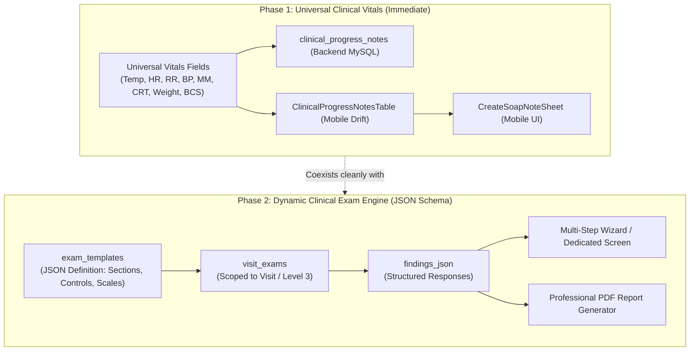

# VetManager: Clinical Examination Architecture & Equine PPE Analysis

> **Document Version**: 1.0  
> **Date**: 2026-11-20  
> **Status**: Architectural Proposal & Analysis  
> **Scope**: Backend (`vet-manager`), Mobile (`vet-manager-mobile`), Full-Stack Parity & Dynamic Taxonomy  

---

## 1. Executive Summary

This document presents a comprehensive architectural and business analysis derived from the evaluation of the standard **AAEP (American Association of Equine Practitioners) 20-Page Pre-Purchase Examination (PPE)** form against VetManager's core architecture.

While our initial diagnosis correctly identified missing vital signs in the mobile UI and the absence of structured physical examination tooling, this document addresses the critical **architectural and business pitfalls** of attempting to build species-specific hardcoded forms. It establishes a resilient two-phase roadmap:
1. **Phase 1 (Immediate Quick Win)**: Universal vital signs completion across Backend & Mobile with zero over-engineering.
2. **Phase 2 (Architectural Solution)**: Dynamic Clinical Exam Templates Engine using JSON Schema under Level 3 (`Visit`), preserving dynamic `species` taxonomy and full-stack sync parity.

---

## 2. Analysis of the AAEP Equine PPE Form (20 Pages)

The analyzed document is an exhaustive, legally binding clinical protocol used internationally in high-value equine acquisitions:

| Section | Pages | Clinical Scope & Key Elements |
| :--- | :---: | :--- |
| **Legal & Disclaimers** | 1–2 | • Legal disclaimer: Professional opinion, not price or fitness guarantee. • Prior Knowledge Disclosure & Consent (conflict of interest waiver). • Full entity records: Purchaser, Seller, respective Agents & Attending Veterinarians. |
| **Identification & Signalment** | 3 | • Registered & barn name, breed, sex, age, color, height, weight, microchip. • Current use, intended discipline, purchaser specific concerns. • Examination conditions & photographic identification records. |
| **Physical Exam & Surgical Scars** | 4–7 | • Vitals: Temp (°F/°C), HR (bpm), RR (rpm), MM, CRT (sec), BCS (1–9). • Surgical scar checklist: Laryngoplasty, Ventriculectomy, Laparotomy/Colic, Neurectomy (LF/RF/LH/RH), Desmotomy, Caslick. • Systematic physical exam: Cardiac auscultation, respiratory rebreathing, ophthalmic reflexes (PLR, Menace, Dazzle, Cornea, Retina), oral/dental, neurologic ataxia checks. |
| **Musculoskeletal & Palpation** | 8–14 | • Conformation, symmetry of spine/pelvis (tuber sacrale, tuber coxae, kissing spines). • Systematic palpation of all 4 limbs (LF, RF, LH, RH): Shoulder, carpus, splints, fetlock, pastern, navicular. • Joint & synovial effusion grading: None, Mild, Moderate, Severe. • Flexor tendons & ligaments: SDFT, DDFT, Check Ligament, Suspensory branch palpation. |
| **Dynamic Exam & AAEP Lameness** | 15–18 | • Hoof tester response per foot (LF, RF, LH, RH). • AAEP Lameness Scale (0 to 5) during walk/jog in hand, circles, and figure-8. • Upper and lower limb flexion tests per limb. • Lungeing and ridden examination under saddle, canter lead changes. • Post-exercise cardiovascular & respiratory recovery time. |
| **Diagnostics & Consultation** | 19–20 | • Laboratory panels: Drug screen (sedatives/NSAIDs), CBC, Coggins, Lyme, EPM, genetic panels. • Diagnostic imaging checklist: Radiographs (X-rays), Ultrasound, Endoscopy, CT/MRI. • Record of final discussion with buyer (in person / telephone). |

---

## 3. The Architectural & Business Pitfall: The Hardcoding Trap

Attempting to implement this 20-page document by creating dedicated equine tables or adding 150+ fixed SQL columns (e.g., `carpus_effusion_lf`, `sdft_palpation_rh`, `flexion_score_lh`) introduces three severe failures:

### Pitfall 1: Breaking the Dynamic `Species` Taxonomy
* VetManager recently transitioned to a dynamic biological species taxonomy (`species` table supporting Canine, Feline, Equine, Bovine, Ovine, Caprine, Avian, Camel, etc.).
* Sinking rigid equine-specific columns into patient or visit tables pollutes the schema, creating dead columns for 90% of non-equine patients and causing severe architectural conflicts.

### Pitfall 2: Sync Engine & Schema Migration Nightmare
* VetManager enforces strict **100% Full-Stack Architectural Parity** between Laravel Eloquent (MySQL) and Mobile Drift (SQLite) via bidirectional offline-first sync.
* Adding 150 fixed columns requires:
  - Massive MySQL schema migrations.
  - Corresponding Dart Drift SQLite table schema migrations.
  - Complex payload serializations in `SyncController.php` and `ProcessSyncMutationsJob.php`.
  - Any future change to a clinical checklist (e.g., adding an ultrasound finding) would trigger cascading cross-platform migrations and risk sync desynchronization.

### Pitfall 3: Mobile UX Breakdown
* Trying to pack a 20-page examination into the existing `CreateSoapNoteSheet` (a modal bottom sheet designed for quick notes) creates an unusable user experience on mobile devices.

---

## 4. The Sound Engineering Solution: 2-Tier Architecture

---

### Phase 1: Universal Vitals Completion (Immediate Quick Win)
Zero over-engineering. Universal across all animal species.

1. **Leverage Existing Backend Schema:**
   The backend table `clinical_progress_notes` already contains:
   * `temperature_c` (decimal)
   * `heart_rate_bpm` (int)
   * `respiratory_rate` (int)
   * `systolic_bp` (int)
   * `diastolic_bp` (int)
   * `mucous_membrane` (string)
   * `weight_kg` (decimal)

2. **Full-Stack Parity Additions:**
   * Add `crt_seconds` (decimal:1) to backend and mobile.
   * Add `systolic_bp`, `diastolic_bp`, `mucous_membrane`, and `crt_seconds` to Drift SQLite `ClinicalProgressNotesTable`.
   * Expose these input fields cleanly inside `CreateSoapNoteSheet` in the mobile app.
   * Update `ProcessSyncMutationsJob.php` and mobile `SyncEngine` serialization.

---

### Phase 2: Dynamic Clinical Exam Templates Engine (JSON Schema)

Rather than rigid relational columns, structured examinations follow a dynamic template pattern scoped under **Level 3 (`Visit`)**:

#### 1. Schema Design

##### A. `exam_templates` Table
Stores template definitions (e.g., *Equine Pre-Purchase Exam (AAEP)*, *Canine Comprehensive Dental*, *Camel Breeding Soundness*, *Bovine Herd Health*):
* `id` (UUID, Primary Key)
* `code` (string, unique, e.g. `aaep_equine_ppe_v1`)
* `name` (string, e.g. "AAEP Equine Pre-Purchase Exam")
* `species_code` (string, nullable, links to `species.code` if specialized, or null for general)
* `version` (int)
* `schema_json` (JSON definition: sections, items, widget types: `checkbox`, `tri_state_na` [Normal/Abnormal/Not Performed], `scale_0_5`, `measurement`, `image_slot`)
* `is_active` (boolean)
* `created_at`, `updated_at`, `deleted_at`

##### B. `visit_exams` Table
Stores the actual clinical findings for a specific visit:
* `id` (UUID, Primary Key)
* `visit_id` (UUID, Foreign Key to `visits.id`, Cascade Delete)
* `template_id` (UUID, Foreign Key to `exam_templates.id`)
* `examiner_id` (UUID, Foreign Key to `users.id`)
* `status` (string: `draft`, `completed`, `signed_locked`)
* `findings_json` (JSON payload containing user answers keyed by item ID)
* `summary_notes` (text, nullable)
* `is_signed` (boolean, default false)
* `signed_at` (timestamp, nullable)
* `created_at`, `updated_at`

#### 2. Key Architectural Advantages
1. **100% Species Taxonomy Compatibility**: Templates can be bound to specific species or left universal, without any schema alteration.
2. **Single Sync Protocol**: The sync engine handles only `exam_templates` and `visit_exams`. New templates require zero database migrations.
3. **Immutability & Medical Integrity**: When a visit is signed, `visit_exams.is_signed = true` locks `findings_json` permanently.
4. **Clean Mobile UX**: Rendered via a dedicated multi-step wizard or tabbed screen within `VisitDetailScreen`, keeping `CreateSoapNoteSheet` fast and lightweight.
5. **Direct PDF Generation**: A universal Blade/PDF transformer compiles `schema_json` + `findings_json` into a branded, multi-page client report.

---

## 5. Strategic Business Decision & Market Prioritization

Before committing engineering resources to Phase 2, leadership must define market priorities:

| Target Market Segment | Business Value & Fit | Recommended Engineering Priority |
| :--- | :--- | :--- |
| **Equine & Arabian Horse Hospitals** | **Extremely High Ticket**: The PPE for Arabian horses and sport horses is a premium service ($500–$2,000 per exam). Having an automated AAEP-compliant PPE with PDF export is a major market differentiator and sales closer. | High priority for Phase 2 once initial core adoption is verified. |
| **Small Animal Companion Clinics** | **High Volume, Lower Form Complexity**: Small animal clinics focus heavily on speed, vaccines, surgeries, and daily SOAP progress notes. | Phase 1 (Universal Vitals) fulfills 100% of their day-to-day requirements. |

---

## 6. Implementation Action Plan

1. **Step 1 (Immediate)**: Implement Phase 1 Universal Vitals (Blood Pressure, Mucous Membranes, CRT) across Backend migration, Drift schema, sync job, and mobile UI.
2. **Step 2**: Author JSON schema definitions for standard exam templates.
3. **Step 3**: Provision `exam_templates` and `visit_exams` with full offline-first Drift parity.
4. **Step 4**: Build dedicated dynamic form renderer and PDF report exporter.

---

# Addendum: Principal Systems Architect Review (Claude 3.7 / OpenRouter Evaluation)

> **Evaluator**: Principal Systems Architect (via Claude 3.7 / OpenRouter)  
> **Verdict**: **APPROVED DIRECTION, with mandatory architectural safeguards before Phase 2.**

---

### Key Takeaways & Blindspots Identified

#### 1. 🔴 Critical: The Multi-Device Offline Sync Trap (Document-level LWW vs Item-Level)
* **The Reality in the Field**: In a barn/equine hospital, a PPE is routinely **multi-actor** (e.g., a veterinary technician records vitals, microchip scan, and identification photos while the veterinarian conducts the lameness flexion tests and dynamic trot, often on two offline devices simultaneously).
* **The Danger**: If `findings_json` is synced as a single opaque JSON document under row-level Last-Write-Wins (LWW), the second device to sync will **completely obliterate the first device's findings**.
* **Mandatory Architecture**:
  * Emitted mutations must be item-level: `exam.set_finding(exam_id, item_path, value, hlc)`.
  * `ProcessSyncMutationsJob.php` merges per item path using Hybrid Logical Clocks (HLC), logging conflicts rather than blindly dropping data.

#### 2. 🔴 Critical: The Three-Party Domain Problem (Purchaser ≠ Owner)
* In standard visits, `Patient -> Client (Owner) -> Visit`.
* In a Pre-Purchase Examination (PPE):
  * **Seller**: Owns the patient.
  * **Purchaser**: Commissions and pays for the examination, and **exclusively owns the clinical report**.
  * **Confidentiality Rule**: The seller must **never** see the purchaser's PPE findings or report unless authorized.
* **Architectural Fix**:
  * Introduce `visit_parties` (`visit_id`, `client_id | external_contact`, `role: purchaser | seller | agent | referring_vet`, `is_report_recipient`, `consent_artifact_id`).
  * Never bury party data in `findings_json` because it governs permissions, billing, and sync distribution.

#### 3. 🔴 Critical: Legal Immutability & Server-Authoritative Signing
* Client signing is purely optimistic UI. Signing is an atomic server mutation (`exam.sign`).
* Any incoming mutations received after server signing must be rejected with `409 EXAM_LOCKED` and redirected to an append-only `visit_exam_addenda` table.
* **Foreign Key Protection**: Change `visits ON DELETE CASCADE` to `ON DELETE RESTRICT` for signed exams. A legal medical report must never be cascade-deleted.
* **Canonical Hashing**: Use RFC 8785 canonical JSON formatting before SHA-256 hashing to prevent false tamper alarms caused by MySQL JSON key reordering and numeric normalization.

#### 4. 🟠 Phase 1 Vitals Hardening (Preventing Partial-Payload Nulling)
* When shipping Phase 1, older app versions in the field might submit progress notes without `crt_seconds`.
* The server sync engine **must enforce PATCH semantics** (missing key = keep existing value, explicit null = clear value) to prevent regression.
* Add `bcs_scale` (`1_9`, `1_5`) alongside `bcs_score` (since equines use Henneke 1–9 while some small animals use 1–5).
* Store temperatures in canonical Celsius (°C) with UI conversion for Fahrenheit (°F) preferences.

#### 5. 🟡 Pragmatic Slicing of Phase 2
Do not attempt Phase 2 as one monolithic release. Slice it into four sequential milestones:
1. **Slice 2.0 (Gate)**: Freeze DSL v1 spec, establish multi-reading vitals model.
2. **Slice 2a (Engine Core)**: Tables, item-level sync, Flutter renderer for basic widgets, proven on a **simple universal template (General Physical Exam)** first.
3. **Slice 2b (Legal & Integrity)**: Server-authoritative signing, RFC 8785 hash, addenda table, immutable signed PDF artifact in object storage.
4. **Slice 2c (Equine PPE Specialized)**: Matrix layout (limbs × structures), attachments pipeline, `visit_parties`, AAEP template content.
