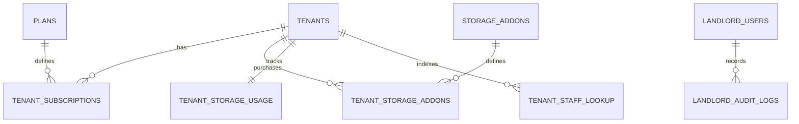
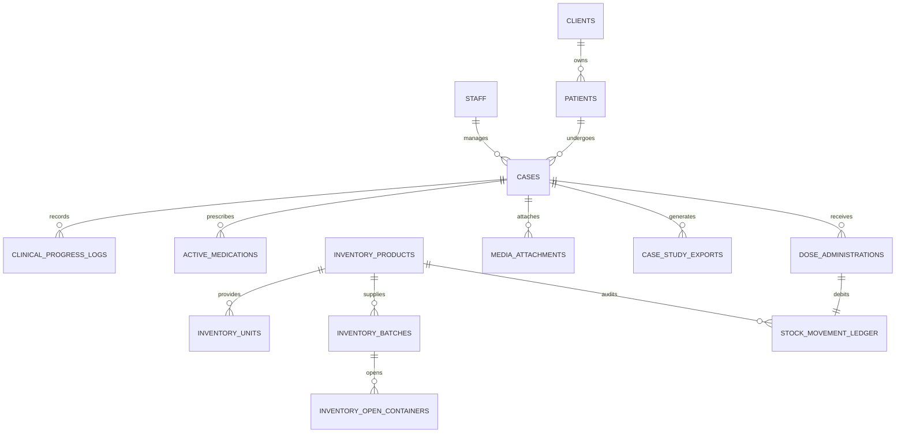
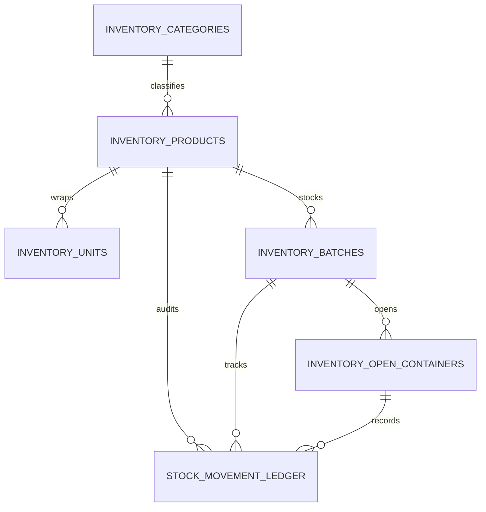

# VetManager: Complete Database Schema Specification

| Document Metadata | Specification Detail |
| :--- | :--- |
| **System** | VetManager (Multi-Tenant B2B SaaS for Veterinary Clinics & Hospitals) |
| **Status** | Production-Grade Database Schema Specification (v1.0.0) |
| **Target Engine** | MySQL 8.0+ (InnoDB, UTF8mb4, Strict SQL Mode) |
| **Isolation Model** | Database-Per-Tenant (Central Landlord DB + Isolated Tenant DBs) |
| **Document Path** | `/docs/DATABASE_SCHEMA.md` |

---

## 1. Schema Architecture Overview & Invariants

VetManager utilizes a strict **Database-Per-Tenant** pattern. The physical database layout is bifurcated into:
1. **Central / Landlord DB (`vetmanager_central`)**: Houses subscription tiers, tenant connection metadata, storage quota balances, global user routing, and central billing audits.
2. **Tenant DB (`vetmanager_tenant_{uuid}`)**: Isolated clinical schema per veterinary practice, hosting clients, patients, clinical cases, immutable SOAP/vital logs, fractional pharmaceuticals, open containers, and media records.

### Database Conventions & Standards
- **Primary Keys**: UUID v7 (or UUID v4 `CHAR(36)`) for distributed uniqueness, mobile offline-first synchronization resilience, and non-enumerable clinical records.
- **Engine**: `InnoDB` with `ROW_FORMAT=DYNAMIC`.
- **Character Set**: `utf8mb4` with collation `utf8mb4_unicode_ci` for multi-lingual and scientific character support.
- **Precision Currency**: Stored as integer cents (`BIGINT UNSIGNED` or `INT UNSIGNED`) to eliminate floating-point rounding errors.
- **High-Precision Inventory**: Base quantities stored as `DECIMAL(14, 4)` to allow fractional microliter, gram, and fractional tablet administration.
- **Vitals & Clinical Measures**: Stored with explicit medical precision (e.g., patient weight `DECIMAL(8, 3)` for neonatal/exotic precision down to 1 gram; temperature `DECIMAL(4, 2)` Celsius).
- **Audit Trails**: All core tables maintain `created_at` and `updated_at` timestamps with timezone handling in UTC. Immutable tables (ledger, clinical logs) omit `updated_at` or lock updates through database triggers.

---

## 2. Central / Landlord Database Schema (`vetmanager_central`)

The central database orchestrates tenancy, billing, and storage quotas.



---

### 2.1 Table: `tenants`
Stores clinical tenant registration, isolated database connection parameters, and lifecycle status.

| Field Name | Type | Nullable | Default | Constraints / Index | Description |
| :--- | :--- | :--- | :--- | :--- | :--- |
| `id` | `CHAR(36)` | NO | None | PRIMARY KEY | UUID v4/v7 tenant identifier |
| `name` | `VARCHAR(191)` | NO | None | INDEX | Legal name of clinic or veterinary hospital |
| `slug` | `VARCHAR(64)` | NO | None | UNIQUE KEY | Subdomain identifier (e.g. `alpha-vet`) |
| `custom_domain` | `VARCHAR(191)` | YES | NULL | UNIQUE KEY | Optional custom enterprise domain |
| `database_name` | `VARCHAR(64)` | NO | None | UNIQUE KEY | Dedicated MySQL database name |
| `database_host` | `VARCHAR(191)` | NO | `'127.0.0.1'` | None | Database server host or cluster IP |
| `database_port` | `SMALLINT UNSIGNED` | NO | `3306` | None | Database server connection port |
| `database_username` | `VARCHAR(64)` | NO | None | None | Isolated database user credentials |
| `database_password` | `VARCHAR(255)` | NO | None | None | Encrypted credentials (AES-256 via Laravel) |
| `status` | `ENUM(...)` | NO | `'provisioning'` | INDEX | `provisioning`, `active`, `suspended`, `archived` |
| `timezone` | `VARCHAR(64)` | NO | `'UTC'` | None | Default clinic timezone for clinical reporting |
| `currency` | `CHAR(3)` | NO | `'USD'` | None | ISO 4217 currency code |
| `created_at` | `TIMESTAMP` | NO | CURRENT_TIMESTAMP | None | Record creation timestamp |
| `updated_at` | `TIMESTAMP` | NO | CURRENT_TIMESTAMP ON UPDATE | None | Last update timestamp |

```sql
CREATE TABLE `tenants` (
    `id` CHAR(36) NOT NULL,
    `name` VARCHAR(191) NOT NULL,
    `slug` VARCHAR(64) NOT NULL,
    `custom_domain` VARCHAR(191) NULL,
    `database_name` VARCHAR(64) NOT NULL,
    `database_host` VARCHAR(191) NOT NULL DEFAULT '127.0.0.1',
    `database_port` SMALLINT UNSIGNED NOT NULL DEFAULT 3306,
    `database_username` VARCHAR(64) NOT NULL,
    `database_password` VARCHAR(255) NOT NULL,
    `status` ENUM('provisioning', 'active', 'suspended', 'archived') NOT NULL DEFAULT 'provisioning',
    `timezone` VARCHAR(64) NOT NULL DEFAULT 'UTC',
    `currency` CHAR(3) NOT NULL DEFAULT 'USD',
    `created_at` TIMESTAMP NOT NULL DEFAULT CURRENT_TIMESTAMP,
    `updated_at` TIMESTAMP NOT NULL DEFAULT CURRENT_TIMESTAMP ON UPDATE CURRENT_TIMESTAMP,
    PRIMARY KEY (`id`),
    UNIQUE KEY `uk_tenants_slug` (`slug`),
    UNIQUE KEY `uk_tenants_custom_domain` (`custom_domain`),
    UNIQUE KEY `uk_tenants_database_name` (`database_name`),
    INDEX `idx_tenants_status` (`status`)
) ENGINE=InnoDB DEFAULT CHARSET=utf8mb4 COLLATE=utf8mb4_unicode_ci ROW_FORMAT=DYNAMIC;
```

---

### 2.2 Table: `plans`
Defines B2B SaaS tiers, patient/staff limits, and base storage allocations.

| Field Name | Type | Nullable | Default | Constraints / Index | Description |
| :--- | :--- | :--- | :--- | :--- | :--- |
| `id` | `CHAR(36)` | NO | None | PRIMARY KEY | UUID plan identifier |
| `name` | `VARCHAR(100)` | NO | None | None | Display plan name (e.g. Starter, Hospital, Farm Pro) |
| `slug` | `VARCHAR(64)` | NO | None | UNIQUE KEY | Machine identifier |
| `max_staff_members` | `INT UNSIGNED` | NO | `5` | None | Hard ceiling on clinic staff logins |
| `max_active_patients`| `INT UNSIGNED` | NO | `500` | None | Maximum active patient records (0 = unlimited) |
| `base_storage_bytes` | `BIGINT UNSIGNED`| NO | `10737418240` | None | Included base Cloudflare R2 storage (10 GB default) |
| `monthly_price_cents`| `INT UNSIGNED` | NO | None | None | Base subscription price in minor units |
| `is_active` | `TINYINT(1)` | NO | `1` | INDEX | Available for new subscriptions |
| `created_at` | `TIMESTAMP` | NO | CURRENT_TIMESTAMP | None | Record creation timestamp |
| `updated_at` | `TIMESTAMP` | NO | CURRENT_TIMESTAMP ON UPDATE | None | Last update timestamp |

```sql
CREATE TABLE `plans` (
    `id` CHAR(36) NOT NULL,
    `name` VARCHAR(100) NOT NULL,
    `slug` VARCHAR(64) NOT NULL,
    `max_staff_members` INT UNSIGNED NOT NULL DEFAULT 5,
    `max_active_patients` INT UNSIGNED NOT NULL DEFAULT 500,
    `base_storage_bytes` BIGINT UNSIGNED NOT NULL DEFAULT 10737418240, -- 10 GB
    `monthly_price_cents` INT UNSIGNED NOT NULL,
    `is_active` TINYINT(1) NOT NULL DEFAULT 1,
    `created_at` TIMESTAMP NOT NULL DEFAULT CURRENT_TIMESTAMP,
    `updated_at` TIMESTAMP NOT NULL DEFAULT CURRENT_TIMESTAMP ON UPDATE CURRENT_TIMESTAMP,
    PRIMARY KEY (`id`),
    UNIQUE KEY `uk_plans_slug` (`slug`),
    INDEX `idx_plans_is_active` (`is_active`)
) ENGINE=InnoDB DEFAULT CHARSET=utf8mb4 COLLATE=utf8mb4_unicode_ci ROW_FORMAT=DYNAMIC;
```

---

### 2.3 Table: `tenant_subscriptions`
Links tenants to plan contracts, billing lifecycles, and payment gateways.

| Field Name | Type | Nullable | Default | Constraints / Index | Description |
| :--- | :--- | :--- | :--- | :--- | :--- |
| `id` | `CHAR(36)` | NO | None | PRIMARY KEY | UUID subscription identifier |
| `tenant_id` | `CHAR(36)` | NO | None | FK, INDEX | Tenant reference |
| `plan_id` | `CHAR(36)` | NO | None | FK, INDEX | Subscribed plan |
| `gateway_provider` | `VARCHAR(32)` | NO | `'stripe'` | None | Payment processor (`stripe`, `paddle`) |
| `gateway_subscription_id` | `VARCHAR(191)` | YES | NULL | UNIQUE KEY | Remote gateway subscription ID |
| `status` | `ENUM(...)` | NO | `'trialing'` | INDEX | `trialing`, `active`, `past_due`, `canceled` |
| `trial_ends_at` | `TIMESTAMP` | YES | NULL | None | Free trial expiry |
| `current_period_start`| `TIMESTAMP` | NO | CURRENT_TIMESTAMP | None | Billing cycle inception |
| `current_period_end` | `TIMESTAMP` | NO | CURRENT_TIMESTAMP | INDEX | Billing cycle renewal/expiration |
| `canceled_at` | `TIMESTAMP` | YES | NULL | None | Voluntary cancellation timestamp |
| `created_at` | `TIMESTAMP` | NO | CURRENT_TIMESTAMP | None | Record creation timestamp |
| `updated_at` | `TIMESTAMP` | NO | CURRENT_TIMESTAMP ON UPDATE | None | Last update timestamp |

```sql
CREATE TABLE `tenant_subscriptions` (
    `id` CHAR(36) NOT NULL,
    `tenant_id` CHAR(36) NOT NULL,
    `plan_id` CHAR(36) NOT NULL,
    `gateway_provider` VARCHAR(32) NOT NULL DEFAULT 'stripe',
    `gateway_subscription_id` VARCHAR(191) NULL,
    `status` ENUM('trialing', 'active', 'past_due', 'canceled') NOT NULL DEFAULT 'trialing',
    `trial_ends_at` TIMESTAMP NULL,
    `current_period_start` TIMESTAMP NOT NULL DEFAULT CURRENT_TIMESTAMP,
    `current_period_end` TIMESTAMP NOT NULL DEFAULT CURRENT_TIMESTAMP,
    `canceled_at` TIMESTAMP NULL,
    `created_at` TIMESTAMP NOT NULL DEFAULT CURRENT_TIMESTAMP,
    `updated_at` TIMESTAMP NOT NULL DEFAULT CURRENT_TIMESTAMP ON UPDATE CURRENT_TIMESTAMP,
    PRIMARY KEY (`id`),
    UNIQUE KEY `uk_subscriptions_gateway_sub_id` (`gateway_subscription_id`),
    INDEX `idx_subscriptions_tenant_status` (`tenant_id`, `status`),
    INDEX `idx_subscriptions_period_end` (`current_period_end`),
    CONSTRAINT `fk_subscriptions_tenant_id` FOREIGN KEY (`tenant_id`) REFERENCES `tenants` (`id`) ON DELETE CASCADE,
    CONSTRAINT `fk_subscriptions_plan_id` FOREIGN KEY (`plan_id`) REFERENCES `plans` (`id`) ON DELETE RESTRICT
) ENGINE=InnoDB DEFAULT CHARSET=utf8mb4 COLLATE=utf8mb4_unicode_ci ROW_FORMAT=DYNAMIC;
```

---

### 2.4 Tables: `storage_addons` & `tenant_storage_addons`
Enables purchasing modular Cloudflare R2 storage capacity expansions.

```sql
CREATE TABLE `storage_addons` (
    `id` CHAR(36) NOT NULL,
    `name` VARCHAR(100) NOT NULL,
    `capacity_bytes` BIGINT UNSIGNED NOT NULL, -- e.g. 53687091200 for 50 GB
    `monthly_price_cents` INT UNSIGNED NOT NULL,
    `is_active` TINYINT(1) NOT NULL DEFAULT 1,
    `created_at` TIMESTAMP NOT NULL DEFAULT CURRENT_TIMESTAMP,
    `updated_at` TIMESTAMP NOT NULL DEFAULT CURRENT_TIMESTAMP ON UPDATE CURRENT_TIMESTAMP,
    PRIMARY KEY (`id`),
    INDEX `idx_storage_addons_active` (`is_active`)
) ENGINE=InnoDB DEFAULT CHARSET=utf8mb4 COLLATE=utf8mb4_unicode_ci ROW_FORMAT=DYNAMIC;

CREATE TABLE `tenant_storage_addons` (
    `id` CHAR(36) NOT NULL,
    `tenant_id` CHAR(36) NOT NULL,
    `storage_addon_id` CHAR(36) NOT NULL,
    `quantity` SMALLINT UNSIGNED NOT NULL DEFAULT 1,
    `status` ENUM('active', 'canceled') NOT NULL DEFAULT 'active',
    `created_at` TIMESTAMP NOT NULL DEFAULT CURRENT_TIMESTAMP,
    `updated_at` TIMESTAMP NOT NULL DEFAULT CURRENT_TIMESTAMP ON UPDATE CURRENT_TIMESTAMP,
    PRIMARY KEY (`id`),
    INDEX `idx_tenant_storage_addons_lookup` (`tenant_id`, `status`),
    CONSTRAINT `fk_tsa_tenant_id` FOREIGN KEY (`tenant_id`) REFERENCES `tenants` (`id`) ON DELETE CASCADE,
    CONSTRAINT `fk_tsa_addon_id` FOREIGN KEY (`storage_addon_id`) REFERENCES `storage_addons` (`id`) ON DELETE RESTRICT
) ENGINE=InnoDB DEFAULT CHARSET=utf8mb4 COLLATE=utf8mb4_unicode_ci ROW_FORMAT=DYNAMIC;
```

---

### 2.5 Table: `tenant_storage_usage`
Real-time high-concurrency counter for Cloudflare R2 storage quota gating.

| Field Name | Type | Nullable | Default | Constraints / Index | Description |
| :--- | :--- | :--- | :--- | :--- | :--- |
| `id` | `CHAR(36)` | NO | None | PRIMARY KEY | Usage record identifier |
| `tenant_id` | `CHAR(36)` | NO | None | UNIQUE KEY | Isolated tenant reference |
| `current_usage_bytes` | `BIGINT UNSIGNED`| NO | `0` | None | Aggregated object storage volume in bytes |
| `total_files_count` | `INT UNSIGNED` | NO | `0` | None | Count of active media attachments |
| `warning_sent_at` | `TIMESTAMP` | YES | NULL | None | Timestamp of last 90% threshold alert |
| `last_calculated_at` | `TIMESTAMP` | NO | CURRENT_TIMESTAMP | None | Reconciliation timestamp |

```sql
CREATE TABLE `tenant_storage_usage` (
    `id` CHAR(36) NOT NULL,
    `tenant_id` CHAR(36) NOT NULL,
    `current_usage_bytes` BIGINT UNSIGNED NOT NULL DEFAULT 0,
    `total_files_count` INT UNSIGNED NOT NULL DEFAULT 0,
    `warning_sent_at` TIMESTAMP NULL,
    `last_calculated_at` TIMESTAMP NOT NULL DEFAULT CURRENT_TIMESTAMP,
    PRIMARY KEY (`id`),
    UNIQUE KEY `uk_storage_usage_tenant_id` (`tenant_id`),
    CONSTRAINT `fk_storage_usage_tenant_id` FOREIGN KEY (`tenant_id`) REFERENCES `tenants` (`id`) ON DELETE CASCADE
) ENGINE=InnoDB DEFAULT CHARSET=utf8mb4 COLLATE=utf8mb4_unicode_ci ROW_FORMAT=DYNAMIC;
```

---

### 2.6 Table: `tenant_staff_lookup`
Global index mapping staff emails to clinics for seamless multi-tenant authentication and mobile single sign-on routing.

```sql
CREATE TABLE `tenant_staff_lookup` (
    `id` CHAR(36) NOT NULL,
    `email` VARCHAR(191) NOT NULL,
    `tenant_id` CHAR(36) NOT NULL,
    `tenant_staff_id` CHAR(36) NOT NULL,
    `is_active` TINYINT(1) NOT NULL DEFAULT 1,
    `created_at` TIMESTAMP NOT NULL DEFAULT CURRENT_TIMESTAMP,
    `updated_at` TIMESTAMP NOT NULL DEFAULT CURRENT_TIMESTAMP ON UPDATE CURRENT_TIMESTAMP,
    PRIMARY KEY (`id`),
    UNIQUE KEY `uk_staff_lookup_email_tenant` (`email`, `tenant_id`),
    INDEX `idx_staff_lookup_email` (`email`),
    CONSTRAINT `fk_staff_lookup_tenant_id` FOREIGN KEY (`tenant_id`) REFERENCES `tenants` (`id`) ON DELETE CASCADE
) ENGINE=InnoDB DEFAULT CHARSET=utf8mb4 COLLATE=utf8mb4_unicode_ci ROW_FORMAT=DYNAMIC;
```

---

### 2.7 Tables: `landlord_users` & `landlord_audit_logs`
Superadministrator accounts managing platform-wide tenancy, infrastructure health, and billing.

```sql
CREATE TABLE `landlord_users` (
    `id` CHAR(36) NOT NULL,
    `email` VARCHAR(191) NOT NULL,
    `password_hash` VARCHAR(255) NOT NULL,
    `name` VARCHAR(100) NOT NULL,
    `role` ENUM('super_admin', 'billing_ops', 'support_engineer') NOT NULL DEFAULT 'support_engineer',
    `is_active` TINYINT(1) NOT NULL DEFAULT 1,
    `last_login_at` TIMESTAMP NULL,
    `created_at` TIMESTAMP NOT NULL DEFAULT CURRENT_TIMESTAMP,
    `updated_at` TIMESTAMP NOT NULL DEFAULT CURRENT_TIMESTAMP ON UPDATE CURRENT_TIMESTAMP,
    PRIMARY KEY (`id`),
    UNIQUE KEY `uk_landlord_users_email` (`email`)
) ENGINE=InnoDB DEFAULT CHARSET=utf8mb4 COLLATE=utf8mb4_unicode_ci ROW_FORMAT=DYNAMIC;

CREATE TABLE `landlord_audit_logs` (
    `id` CHAR(36) NOT NULL,
    `landlord_user_id` CHAR(36) NULL,
    `tenant_id` CHAR(36) NULL,
    `action` VARCHAR(64) NOT NULL, -- e.g. 'tenant.suspended', 'quota.manually_increased'
    `ip_address` VARCHAR(45) NOT NULL,
    `user_agent` TEXT NULL,
    `payload_before` JSON NULL,
    `payload_after` JSON NULL,
    `created_at` TIMESTAMP NOT NULL DEFAULT CURRENT_TIMESTAMP,
    PRIMARY KEY (`id`),
    INDEX `idx_landlord_audit_action` (`action`, `created_at` DESC),
    INDEX `idx_landlord_audit_tenant` (`tenant_id`),
    CONSTRAINT `fk_landlord_audit_user` FOREIGN KEY (`landlord_user_id`) REFERENCES `landlord_users` (`id`) ON DELETE SET NULL,
    CONSTRAINT `fk_landlord_audit_tenant` FOREIGN KEY (`tenant_id`) REFERENCES `tenants` (`id`) ON DELETE SET NULL
) ENGINE=InnoDB DEFAULT CHARSET=utf8mb4 COLLATE=utf8mb4_unicode_ci ROW_FORMAT=DYNAMIC;
```

---

## 3. Isolated Tenant Database Schema (`vetmanager_tenant_{uuid}`)

Every clinic executes against a dedicated MySQL database with zero data leakage across practices.



---

### 3.1 Staff & Permissions: `staff`
Stores clinic-specific veterinary doctors, technicians, and administrators.

| Field Name | Type | Nullable | Default | Constraints / Index | Description |
| :--- | :--- | :--- | :--- | :--- | :--- |
| `id` | `CHAR(36)` | NO | None | PRIMARY KEY | UUID staff identifier |
| `email` | `VARCHAR(191)` | NO | None | UNIQUE KEY | Clinic-scoped login email |
| `password_hash` | `VARCHAR(255)` | NO | None | None | Bcrypt / Argon2id hashed password |
| `first_name` | `VARCHAR(100)` | NO | None | None | Given name |
| `last_name` | `VARCHAR(100)` | NO | None | INDEX | Surname |
| `phone` | `VARCHAR(32)` | YES | NULL | None | Mobile phone for emergency alerts |
| `license_number` | `VARCHAR(64)` | YES | NULL | None | Veterinary medical council license |
| `role` | `ENUM(...)` | NO | `'field_doctor'` | INDEX | `clinic_owner`, `head_vet`, `field_doctor`, `vet_tech`, `receptionist` |
| `is_active` | `TINYINT(1)` | NO | `1` | INDEX | Authentication active flag |
| `last_login_at` | `TIMESTAMP` | YES | NULL | None | Audit timestamp |
| `created_at` | `TIMESTAMP` | NO | CURRENT_TIMESTAMP | None | Record creation timestamp |
| `updated_at` | `TIMESTAMP` | NO | CURRENT_TIMESTAMP ON UPDATE | None | Last update timestamp |

```sql
CREATE TABLE `staff` (
    `id` CHAR(36) NOT NULL,
    `email` VARCHAR(191) NOT NULL,
    `password_hash` VARCHAR(255) NOT NULL,
    `first_name` VARCHAR(100) NOT NULL,
    `last_name` VARCHAR(100) NOT NULL,
    `phone` VARCHAR(32) NULL,
    `license_number` VARCHAR(64) NULL,
    `role` ENUM('clinic_owner', 'head_vet', 'field_doctor', 'vet_tech', 'receptionist') NOT NULL DEFAULT 'field_doctor',
    `is_active` TINYINT(1) NOT NULL DEFAULT 1,
    `last_login_at` TIMESTAMP NULL,
    `created_at` TIMESTAMP NOT NULL DEFAULT CURRENT_TIMESTAMP,
    `updated_at` TIMESTAMP NOT NULL DEFAULT CURRENT_TIMESTAMP ON UPDATE CURRENT_TIMESTAMP,
    PRIMARY KEY (`id`),
    UNIQUE KEY `uk_staff_email` (`email`),
    INDEX `idx_staff_role` (`role`),
    INDEX `idx_staff_active_last_name` (`is_active`, `last_name`)
) ENGINE=InnoDB DEFAULT CHARSET=utf8mb4 COLLATE=utf8mb4_unicode_ci ROW_FORMAT=DYNAMIC;
```

---

### 3.2 Clients: `clients`
Accommodates both urban companion pet owners and rural commercial farm managers.

| Field Name | Type | Nullable | Default | Constraints / Index | Description |
| :--- | :--- | :--- | :--- | :--- | :--- |
| `id` | `CHAR(36)` | NO | None | PRIMARY KEY | UUID client identifier |
| `client_type` | `ENUM(...)` | NO | `'individual'` | INDEX | `individual`, `farm_manager`, `livestock_enterprise` |
| `name` | `VARCHAR(191)` | NO | None | INDEX | Full personal name or farm enterprise name |
| `contact_person` | `VARCHAR(191)` | YES | NULL | None | On-site farm contact or spouse |
| `phone_primary` | `VARCHAR(32)` | NO | None | INDEX | Primary phone |
| `phone_secondary`| `VARCHAR(32)` | YES | NULL | None | Alternate/farm line |
| `email` | `VARCHAR(191)` | YES | NULL | INDEX | Invoicing and report email |
| `tax_vat_number` | `VARCHAR(64)` | YES | NULL | None | Tax ID for agricultural commercial accounts |
| `physical_address`| `TEXT` | YES | NULL | None | Clinic or farm physical address |
| `gps_latitude` | `DECIMAL(10, 7)`| YES | NULL | None | GPS latitude for ambulatory field farm routing |
| `gps_longitude` | `DECIMAL(10, 7)`| YES | NULL | None | GPS longitude for ambulatory field farm routing |
| `notes` | `TEXT` | YES | NULL | None | Biosecurity, gate codes, or client alerts |
| `created_at` | `TIMESTAMP` | NO | CURRENT_TIMESTAMP | None | Record creation timestamp |
| `updated_at` | `TIMESTAMP` | NO | CURRENT_TIMESTAMP ON UPDATE | None | Last update timestamp |

```sql
CREATE TABLE `clients` (
    `id` CHAR(36) NOT NULL,
    `client_type` ENUM('individual', 'farm_manager', 'livestock_enterprise') NOT NULL DEFAULT 'individual',
    `name` VARCHAR(191) NOT NULL,
    `contact_person` VARCHAR(191) NULL,
    `phone_primary` VARCHAR(32) NOT NULL,
    `phone_secondary` VARCHAR(32) NULL,
    `email` VARCHAR(191) NULL,
    `tax_vat_number` VARCHAR(64) NULL,
    `physical_address` TEXT NULL,
    `gps_latitude` DECIMAL(10, 7) NULL,
    `gps_longitude` DECIMAL(10, 7) NULL,
    `notes` TEXT NULL,
    `created_at` TIMESTAMP NOT NULL DEFAULT CURRENT_TIMESTAMP,
    `updated_at` TIMESTAMP NOT NULL DEFAULT CURRENT_TIMESTAMP ON UPDATE CURRENT_TIMESTAMP,
    PRIMARY KEY (`id`),
    INDEX `idx_clients_name` (`name`),
    INDEX `idx_clients_phone_primary` (`phone_primary`),
    INDEX `idx_clients_type` (`client_type`)
) ENGINE=InnoDB DEFAULT CHARSET=utf8mb4 COLLATE=utf8mb4_unicode_ci ROW_FORMAT=DYNAMIC;
```

---

### 3.3 Patients: `patients`
Clinical animal records supporting small companions, equine athletes, and production livestock.

| Field Name | Type | Nullable | Default | Constraints / Index | Description |
| :--- | :--- | :--- | :--- | :--- | :--- |
| `id` | `CHAR(36)` | NO | None | PRIMARY KEY | UUID patient identifier |
| `client_id` | `CHAR(36)` | NO | None | FK, INDEX | Owning client |
| `name_or_tag` | `VARCHAR(100)` | NO | None | INDEX | Pet name or livestock ear tag number |
| `species` | `VARCHAR(64)` | NO | None | INDEX | Canine, Feline, Equine, Bovine, Ovine, etc. |
| `breed` | `VARCHAR(100)` | YES | NULL | None | Breed or breed cross |
| `gender` | `ENUM(...)` | NO | `'unknown'` | None | `intact_male`, `neutered_male`, `intact_female`, `spayed_female`, `unknown` |
| `date_of_birth` | `DATE` | YES | NULL | None | Exact or estimated birth date |
| `is_approximate_age` | `TINYINT(1)` | NO | `0` | None | True if age estimated by dentition |
| `microchip_number` | `VARCHAR(32)` | YES | NULL | UNIQUE KEY | ISO 11784/11785 15-digit microchip |
| `ear_tag_id` | `VARCHAR(64)` | YES | NULL | INDEX | Agricultural herd ear tag identification |
| `passport_number` | `VARCHAR(64)` | YES | NULL | None | FEI / equine passport number |
| `coat_color_markings` | `VARCHAR(191)` | YES | NULL | None | Distinctive physiological markings |
| `current_weight_kg` | `DECIMAL(8, 3)`| YES | NULL | None | Weight in kg (precision: 0.001 kg = 1 gram) |
| `weight_recorded_at`| `TIMESTAMP` | YES | NULL | None | Timestamp of last verified scale reading |
| `status` | `ENUM(...)` | NO | `'active'` | INDEX | `active`, `deceased`, `transferred`, `archived` |
| `deceased_at` | `TIMESTAMP` | YES | NULL | None | Timestamp of verified death / euthanasia |
| `created_at` | `TIMESTAMP` | NO | CURRENT_TIMESTAMP | None | Record creation timestamp |
| `updated_at` | `TIMESTAMP` | NO | CURRENT_TIMESTAMP ON UPDATE | None | Last update timestamp |

```sql
CREATE TABLE `patients` (
    `id` CHAR(36) NOT NULL,
    `client_id` CHAR(36) NOT NULL,
    `name_or_tag` VARCHAR(100) NOT NULL,
    `species` VARCHAR(64) NOT NULL,
    `breed` VARCHAR(100) NULL,
    `gender` ENUM('intact_male', 'neutered_male', 'intact_female', 'spayed_female', 'unknown') NOT NULL DEFAULT 'unknown',
    `date_of_birth` DATE NULL,
    `is_approximate_age` TINYINT(1) NOT NULL DEFAULT 0,
    `microchip_number` VARCHAR(32) NULL,
    `ear_tag_id` VARCHAR(64) NULL,
    `passport_number` VARCHAR(64) NULL,
    `coat_color_markings` VARCHAR(191) NULL,
    `current_weight_kg` DECIMAL(8, 3) NULL,
    `weight_recorded_at` TIMESTAMP NULL,
    `status` ENUM('active', 'deceased', 'transferred', 'archived') NOT NULL DEFAULT 'active',
    `deceased_at` TIMESTAMP NULL,
    `created_at` TIMESTAMP NOT NULL DEFAULT CURRENT_TIMESTAMP,
    `updated_at` TIMESTAMP NOT NULL DEFAULT CURRENT_TIMESTAMP ON UPDATE CURRENT_TIMESTAMP,
    PRIMARY KEY (`id`),
    UNIQUE KEY `uk_patients_microchip` (`microchip_number`),
    INDEX `idx_patients_client_status` (`client_id`, `status`),
    INDEX `idx_patients_species_breed` (`species`, `breed`),
    INDEX `idx_patients_ear_tag` (`ear_tag_id`),
    CONSTRAINT `fk_patients_client_id` FOREIGN KEY (`client_id`) REFERENCES `clients` (`id`) ON DELETE RESTRICT
) ENGINE=InnoDB DEFAULT CHARSET=utf8mb4 COLLATE=utf8mb4_unicode_ci ROW_FORMAT=DYNAMIC;
```

---

### 3.4 Clinical Cases: `cases`
Encapsulates hospital admissions, outpatient consultations, and field ambulatory farm calls.

| Field Name | Type | Nullable | Default | Constraints / Index | Description |
| :--- | :--- | :--- | :--- | :--- | :--- |
| `id` | `CHAR(36)` | NO | None | PRIMARY KEY | UUID case identifier |
| `case_number` | `VARCHAR(32)` | NO | None | UNIQUE KEY | Formatted clinical code (e.g. `CAS-2026-00042`) |
| `patient_id` | `CHAR(36)` | NO | None | FK, INDEX | Admitted patient |
| `primary_veterinarian_id` | `CHAR(36)` | NO | None | FK, INDEX | Attending veterinary doctor |
| `case_type` | `ENUM(...)` | NO | `'outpatient'` | INDEX | `inpatient`, `outpatient`, `field_farm_visit` |
| `status` | `ENUM(...)` | NO | `'open'` | INDEX | `open`, `under_observation`, `critical_care`, `discharged`, `closed` |
| `priority` | `ENUM(...)` | NO | `'routine'` | None | `routine`, `urgent`, `emergency_critical` |
| `chief_complaint` | `VARCHAR(255)` | NO | None | None | Presenting complaint / emergency reason |
| `provisional_diagnosis` | `TEXT` | YES | NULL | None | Initial differential diagnosis |
| `final_diagnosis` | `TEXT` | YES | NULL | None | Confirmed diagnosis post-workup |
| `admitted_at` | `TIMESTAMP` | NO | CURRENT_TIMESTAMP | INDEX | Inpatient admission / visit start |
| `discharged_at`| `TIMESTAMP` | YES | NULL | None | Hospital discharge / visit completion |
| `created_at` | `TIMESTAMP` | NO | CURRENT_TIMESTAMP | None | Record creation timestamp |
| `updated_at` | `TIMESTAMP` | NO | CURRENT_TIMESTAMP ON UPDATE | None | Last update timestamp |

```sql
CREATE TABLE `cases` (
    `id` CHAR(36) NOT NULL,
    `case_number` VARCHAR(32) NOT NULL,
    `patient_id` CHAR(36) NOT NULL,
    `primary_veterinarian_id` CHAR(36) NOT NULL,
    `case_type` ENUM('inpatient', 'outpatient', 'field_farm_visit') NOT NULL DEFAULT 'outpatient',
    `status` ENUM('open', 'under_observation', 'critical_care', 'discharged', 'closed') NOT NULL DEFAULT 'open',
    `priority` ENUM('routine', 'urgent', 'emergency_critical') NOT NULL DEFAULT 'routine',
    `chief_complaint` VARCHAR(255) NOT NULL,
    `provisional_diagnosis` TEXT NULL,
    `final_diagnosis` TEXT NULL,
    `admitted_at` TIMESTAMP NOT NULL DEFAULT CURRENT_TIMESTAMP,
    `discharged_at` TIMESTAMP NULL,
    `created_at` TIMESTAMP NOT NULL DEFAULT CURRENT_TIMESTAMP,
    `updated_at` TIMESTAMP NOT NULL DEFAULT CURRENT_TIMESTAMP ON UPDATE CURRENT_TIMESTAMP,
    PRIMARY KEY (`id`),
    UNIQUE KEY `uk_cases_case_number` (`case_number`),
    INDEX `idx_cases_patient_status` (`patient_id`, `status`),
    INDEX `idx_cases_vet_status` (`primary_veterinarian_id`, `status`),
    INDEX `idx_cases_type_admitted` (`case_type`, `admitted_at`),
    CONSTRAINT `fk_cases_patient_id` FOREIGN KEY (`patient_id`) REFERENCES `patients` (`id`) ON DELETE RESTRICT,
    CONSTRAINT `fk_cases_primary_vet_id` FOREIGN KEY (`primary_veterinarian_id`) REFERENCES `staff` (`id`) ON DELETE RESTRICT
) ENGINE=InnoDB DEFAULT CHARSET=utf8mb4 COLLATE=utf8mb4_unicode_ci ROW_FORMAT=DYNAMIC;
```

---

### 3.5 Daily Clinical Progress Logs: `clinical_progress_logs`
An **immutable chronological timeline** capturing vital signs, physical examinations, and SOAP progress entries. Malpractice safety is guaranteed: logs are non-updatable; revisions are modeled via append-only addenda.

| Field Name | Type | Nullable | Default | Constraints / Index | Description |
| :--- | :--- | :--- | :--- | :--- | :--- |
| `id` | `CHAR(36)` | NO | None | PRIMARY KEY | UUID log identifier |
| `case_id` | `CHAR(36)` | NO | None | FK, INDEX | Parent clinical case |
| `staff_id` | `CHAR(36)` | NO | None | FK, INDEX | Authoring doctor or veterinary technician |
| `log_type` | `ENUM(...)` | NO | `'soap_note'` | INDEX | `soap_note`, `vital_signs`, `examination`, `triage_entry`, `surgical_note`, `nursing_care`, `discharge_summary` |
| `logged_at` | `TIMESTAMP` | NO | CURRENT_TIMESTAMP | INDEX | Medical timestamp of observation |
| `soap_subjective`| `TEXT` | YES | NULL | None | Owner observations, attitude, appetite |
| `soap_objective` | `TEXT` | YES | NULL | None | Clinical findings, auscultation, palpation |
| `soap_assessment`| `TEXT` | YES | NULL | None | Pathophysiologic interpretation |
| `soap_plan` | `TEXT` | YES | NULL | None | Diagnostic plan, fluid rate, therapy |
| `temperature_celsius` | `DECIMAL(4, 2)`| YES | NULL | None | Core rectal temperature (e.g. 38.65 °C) |
| `heart_rate_bpm` | `SMALLINT UNSIGNED`| YES | NULL | None | Cardiac auscultation rate |
| `respiratory_rate_bpm`| `SMALLINT UNSIGNED`| YES | NULL | None | Breaths per minute |
| `mucosal_color` | `ENUM(...)` | YES | NULL | None | `pink`, `pale`, `cyanotic`, `icteric`, `hyperemic`, `injected`, `muddy` |
| `capillary_refill_time_sec`| `DECIMAL(3, 1)`| YES | NULL | None | Capillary refill time (e.g. 1.5 seconds) |
| `systolic_bp_mmhg` | `SMALLINT UNSIGNED`| YES | NULL | None | Systolic blood pressure (Doppler / oscillometric) |
| `diastolic_bp_mmhg`| `SMALLINT UNSIGNED`| YES | NULL | None | Diastolic blood pressure |
| `pain_score` | `TINYINT UNSIGNED` | YES | NULL | None | Colorado / Glasgow pain scale (0 to 10) |
| `body_condition_score`| `TINYINT UNSIGNED` | YES | NULL | None | BCS scale (1-9 standard system) |
| `recorded_weight_kg` | `DECIMAL(8, 3)`| YES | NULL | None | Animal weight at examination |
| `is_immutable` | `TINYINT(1)` | NO | `1` | None | Enforces non-mutability |
| `signed_at` | `TIMESTAMP` | NO | CURRENT_TIMESTAMP | None | Cryptographic / legal medical sign-off |
| `addendum_to_log_id`| `CHAR(36)` | YES | NULL | FK, INDEX | Self-reference for corrective addendum chain |
| `created_at` | `TIMESTAMP` | NO | CURRENT_TIMESTAMP | None | Record ingestion timestamp |

```sql
CREATE TABLE `clinical_progress_logs` (
    `id` CHAR(36) NOT NULL,
    `case_id` CHAR(36) NOT NULL,
    `staff_id` CHAR(36) NOT NULL,
    `log_type` ENUM('soap_note', 'vital_signs', 'examination', 'triage_entry', 'surgical_note', 'nursing_care', 'discharge_summary') NOT NULL DEFAULT 'soap_note',
    `logged_at` TIMESTAMP NOT NULL DEFAULT CURRENT_TIMESTAMP,
    `soap_subjective` TEXT NULL,
    `soap_objective` TEXT NULL,
    `soap_assessment` TEXT NULL,
    `soap_plan` TEXT NULL,
    `temperature_celsius` DECIMAL(4, 2) NULL,
    `heart_rate_bpm` SMALLINT UNSIGNED NULL,
    `respiratory_rate_bpm` SMALLINT UNSIGNED NULL,
    `mucosal_color` ENUM('pink', 'pale', 'cyanotic', 'icteric', 'hyperemic', 'injected', 'muddy') NULL,
    `capillary_refill_time_sec` DECIMAL(3, 1) NULL,
    `systolic_bp_mmhg` SMALLINT UNSIGNED NULL,
    `diastolic_bp_mmhg` SMALLINT UNSIGNED NULL,
    `pain_score` TINYINT UNSIGNED NULL,
    `body_condition_score` TINYINT UNSIGNED NULL,
    `recorded_weight_kg` DECIMAL(8, 3) NULL,
    `is_immutable` TINYINT(1) NOT NULL DEFAULT 1,
    `signed_at` TIMESTAMP NOT NULL DEFAULT CURRENT_TIMESTAMP,
    `addendum_to_log_id` CHAR(36) NULL,
    `created_at` TIMESTAMP NOT NULL DEFAULT CURRENT_TIMESTAMP,
    PRIMARY KEY (`id`),
    INDEX `idx_logs_case_timeline` (`case_id`, `logged_at` DESC),
    INDEX `idx_logs_staff_audit` (`staff_id`, `created_at`),
    INDEX `idx_logs_addendum` (`addendum_to_log_id`),
    CONSTRAINT `fk_logs_case_id` FOREIGN KEY (`case_id`) REFERENCES `cases` (`id`) ON DELETE CASCADE,
    CONSTRAINT `fk_logs_staff_id` FOREIGN KEY (`staff_id`) REFERENCES `staff` (`id`) ON DELETE RESTRICT,
    CONSTRAINT `fk_logs_addendum_id` FOREIGN KEY (`addendum_to_log_id`) REFERENCES `clinical_progress_logs` (`id`) ON DELETE RESTRICT
) ENGINE=InnoDB DEFAULT CHARSET=utf8mb4 COLLATE=utf8mb4_unicode_ci ROW_FORMAT=DYNAMIC;
```

---

### 3.6 Active Medications: `active_medications`
Tracks pharmacological treatment protocols with adjustment lineage and discontinuation logs.

| Field Name | Type | Nullable | Default | Constraints / Index | Description |
| :--- | :--- | :--- | :--- | :--- | :--- |
| `id` | `CHAR(36)` | NO | None | PRIMARY KEY | UUID medication prescription |
| `case_id` | `CHAR(36)` | NO | None | FK, INDEX | Parent case |
| `product_id` | `CHAR(36)` | NO | None | FK, INDEX | Prescribed pharmaceutical |
| `prescribed_by_staff_id`| `CHAR(36)` | NO | None | FK | Prescribing veterinarian |
| `prescribed_dose_amount` | `DECIMAL(12, 4)`| NO | None | None | Dose per administration in base units |
| `frequency` | `VARCHAR(32)` | NO | None | None | SID, BID, TID, QID, q12h, PRN, CRI |
| `route` | `ENUM(...)` | NO | `'PO'` | None | `IV`, `IM`, `SC`, `PO`, `topical`, `ophthalmic`, `otic`, `inhalation`, `epidural` |
| `start_date` | `DATE` | NO | None | None | Therapy commencement |
| `end_date` | `DATE` | YES | NULL | None | Therapy conclusion date |
| `special_instructions` | `TEXT` | YES | NULL | None | e.g. With food, titrate CRI |
| `status` | `ENUM(...)` | NO | `'active'` | INDEX | `active`, `dosage_adjusted`, `discontinued`, `completed` |
| `adjusted_from_id` | `CHAR(36)` | YES | NULL | FK, INDEX | Ancestor medication order for dose changes |
| `discontinuation_reason`| `TEXT` | YES | NULL | None | Malpractice audit reason for stopping |
| `discontinued_by_staff_id`| `CHAR(36)` | YES | NULL | FK | Veterinarian who halted medication |
| `discontinued_at` | `TIMESTAMP` | YES | NULL | None | Discontinuation timestamp |
| `created_at` | `TIMESTAMP` | NO | CURRENT_TIMESTAMP | None | Record creation timestamp |
| `updated_at` | `TIMESTAMP` | NO | CURRENT_TIMESTAMP ON UPDATE | None | Last update timestamp |

```sql
CREATE TABLE `active_medications` (
    `id` CHAR(36) NOT NULL,
    `case_id` CHAR(36) NOT NULL,
    `product_id` CHAR(36) NOT NULL,
    `prescribed_by_staff_id` CHAR(36) NOT NULL,
    `prescribed_dose_amount` DECIMAL(12, 4) NOT NULL,
    `frequency` VARCHAR(32) NOT NULL,
    `route` ENUM('IV', 'IM', 'SC', 'PO', 'topical', 'ophthalmic', 'otic', 'inhalation', 'epidural') NOT NULL DEFAULT 'PO',
    `start_date` DATE NOT NULL,
    `end_date` DATE NULL,
    `special_instructions` TEXT NULL,
    `status` ENUM('active', 'dosage_adjusted', 'discontinued', 'completed') NOT NULL DEFAULT 'active',
    `adjusted_from_id` CHAR(36) NULL,
    `discontinuation_reason` TEXT NULL,
    `discontinued_by_staff_id` CHAR(36) NULL,
    `discontinued_at` TIMESTAMP NULL,
    `created_at` TIMESTAMP NOT NULL DEFAULT CURRENT_TIMESTAMP,
    `updated_at` TIMESTAMP NOT NULL DEFAULT CURRENT_TIMESTAMP ON UPDATE CURRENT_TIMESTAMP,
    PRIMARY KEY (`id`),
    INDEX `idx_meds_case_status` (`case_id`, `status`),
    INDEX `idx_meds_product` (`product_id`),
    INDEX `idx_meds_adjusted_from` (`adjusted_from_id`),
    CONSTRAINT `fk_meds_case_id` FOREIGN KEY (`case_id`) REFERENCES `cases` (`id`) ON DELETE CASCADE,
    CONSTRAINT `fk_meds_product_id` FOREIGN KEY (`product_id`) REFERENCES `inventory_products` (`id`) ON DELETE RESTRICT,
    CONSTRAINT `fk_meds_staff_id` FOREIGN KEY (`prescribed_by_staff_id`) REFERENCES `staff` (`id`) ON DELETE RESTRICT,
    CONSTRAINT `fk_meds_adjusted_id` FOREIGN KEY (`adjusted_from_id`) REFERENCES `active_medications` (`id`) ON DELETE SET NULL,
    CONSTRAINT `fk_meds_disc_staff_id` FOREIGN KEY (`discontinued_by_staff_id`) REFERENCES `staff` (`id`) ON DELETE RESTRICT
) ENGINE=InnoDB DEFAULT CHARSET=utf8mb4 COLLATE=utf8mb4_unicode_ci ROW_FORMAT=DYNAMIC;
```

---

## 4. High-Precision Fractional Inventory Engine Schema

Veterinary medicine operates on microscopic fractional doses (e.g. `0.35 ml` sedatives, `0.5 tablet` NSAIDs). Stock is modeled with the **Base Unit First Principle** with rigorous physical container lifecycle tracking.



---

### 4.1 Categories & Products: `inventory_categories` & `inventory_products`
All physical quantities are normalized to their smallest indivisible unit (`ml`, `mg`, `tablet`, `gram`, `drop`).

```sql
CREATE TABLE `inventory_categories` (
    `id` CHAR(36) NOT NULL,
    `name` VARCHAR(100) NOT NULL,
    `slug` VARCHAR(64) NOT NULL,
    `created_at` TIMESTAMP NOT NULL DEFAULT CURRENT_TIMESTAMP,
    `updated_at` TIMESTAMP NOT NULL DEFAULT CURRENT_TIMESTAMP ON UPDATE CURRENT_TIMESTAMP,
    PRIMARY KEY (`id`),
    UNIQUE KEY `uk_inv_cat_slug` (`slug`)
) ENGINE=InnoDB DEFAULT CHARSET=utf8mb4 COLLATE=utf8mb4_unicode_ci ROW_FORMAT=DYNAMIC;

CREATE TABLE `inventory_products` (
    `id` CHAR(36) NOT NULL,
    `category_id` CHAR(36) NOT NULL,
    `name` VARCHAR(191) NOT NULL,
    `generic_name` VARCHAR(191) NULL,
    `sku` VARCHAR(64) NOT NULL,
    `barcode` VARCHAR(64) NULL,
    `base_unit` ENUM('ml','mg','tablet','gram','drop','piece','vial') NOT NULL,
    `is_prescription_required` TINYINT(1) NOT NULL DEFAULT 1,
    `is_controlled_substance` TINYINT(1) NOT NULL DEFAULT 0,
    `controlled_substance_schedule` VARCHAR(16) NULL, -- e.g. 'Schedule II', 'Schedule IV'
    `minimum_stock_alert_threshold` DECIMAL(14, 4) NOT NULL DEFAULT 0.0000,
    `ideal_reorder_quantity` DECIMAL(14, 4) NOT NULL DEFAULT 0.0000,
    `is_active` TINYINT(1) NOT NULL DEFAULT 1,
    `created_at` TIMESTAMP NOT NULL DEFAULT CURRENT_TIMESTAMP,
    `updated_at` TIMESTAMP NOT NULL DEFAULT CURRENT_TIMESTAMP ON UPDATE CURRENT_TIMESTAMP,
    PRIMARY KEY (`id`),
    UNIQUE KEY `uk_inv_prod_sku` (`sku`),
    INDEX `idx_inv_prod_barcode` (`barcode`),
    INDEX `idx_inv_prod_category` (`category_id`),
    INDEX `idx_inv_prod_controlled` (`is_controlled_substance`),
    CONSTRAINT `fk_inv_prod_cat_id` FOREIGN KEY (`category_id`) REFERENCES `inventory_categories` (`id`) ON DELETE RESTRICT
) ENGINE=InnoDB DEFAULT CHARSET=utf8mb4 COLLATE=utf8mb4_unicode_ci ROW_FORMAT=DYNAMIC;
```

---

### 4.2 Unit Conversion Wrappers: `inventory_units`
Defines packaging conversions referencing the immutable base unit (e.g. 1 Box = 10 Vials; 1 Vial = 50 ml).

```sql
CREATE TABLE `inventory_units` (
    `id` CHAR(36) NOT NULL,
    `product_id` CHAR(36) NOT NULL,
    `unit_name` VARCHAR(64) NOT NULL, -- e.g. '100ml Vial', 'Box of 10x 10ml'
    `base_unit_multiplier` DECIMAL(14, 4) NOT NULL, -- Multiplier to convert to base_unit (e.g. 100.0000)
    `barcode` VARCHAR(64) NULL,
    `is_dispensing_unit` TINYINT(1) NOT NULL DEFAULT 0,
    `created_at` TIMESTAMP NOT NULL DEFAULT CURRENT_TIMESTAMP,
    `updated_at` TIMESTAMP NOT NULL DEFAULT CURRENT_TIMESTAMP ON UPDATE CURRENT_TIMESTAMP,
    PRIMARY KEY (`id`),
    INDEX `idx_inv_units_prod` (`product_id`),
    INDEX `idx_inv_units_barcode` (`barcode`),
    CONSTRAINT `fk_inv_units_prod_id` FOREIGN KEY (`product_id`) REFERENCES `inventory_products` (`id`) ON DELETE CASCADE
) ENGINE=InnoDB DEFAULT CHARSET=utf8mb4 COLLATE=utf8mb4_unicode_ci ROW_FORMAT=DYNAMIC;
```

---

### 4.3 Batches & FEFO Tracking: `inventory_batches`
Guarantees **First-Expired, First-Out (FEFO)** dispensing logic through high-efficiency indexed expiration queries.

| Field Name | Type | Nullable | Default | Constraints / Index | Description |
| :--- | :--- | :--- | :--- | :--- | :--- |
| `id` | `CHAR(36)` | NO | None | PRIMARY KEY | UUID batch identifier |
| `product_id` | `CHAR(36)` | NO | None | FK, INDEX | Pharmaceutical product |
| `batch_number` | `VARCHAR(64)` | NO | None | INDEX | Manufacturer lot number |
| `manufacturer` | `VARCHAR(150)` | YES | NULL | None | Pharmaceutical manufacturer name |
| `expiration_date` | `DATE` | NO | None | INDEX (FEFO) | Batch expiration deadline |
| `unit_cost_cents` | `INT UNSIGNED` | NO | `0` | None | Purchase cost per base unit in minor currency |
| `unit_selling_price_cents`| `INT UNSIGNED` | NO | `0` | None | Billing rate per base unit |
| `initial_base_units` | `DECIMAL(14, 4)`| NO | None | None | Total base volume at receipt |
| `remaining_base_units`| `DECIMAL(14, 4)`| NO | None | INDEX | Live available unsealed/sealed stock |
| `status` | `ENUM(...)` | NO | `'sealed'` | INDEX | `sealed`, `active_opened`, `depleted`, `expired`, `quarantined` |
| `created_at` | `TIMESTAMP` | NO | CURRENT_TIMESTAMP | None | Receiving record timestamp |
| `updated_at` | `TIMESTAMP` | NO | CURRENT_TIMESTAMP ON UPDATE | None | Last update timestamp |

```sql
CREATE TABLE `inventory_batches` (
    `id` CHAR(36) NOT NULL,
    `product_id` CHAR(36) NOT NULL,
    `batch_number` VARCHAR(64) NOT NULL,
    `manufacturer` VARCHAR(150) NULL,
    `expiration_date` DATE NOT NULL,
    `unit_cost_cents` INT UNSIGNED NOT NULL DEFAULT 0,
    `unit_selling_price_cents` INT UNSIGNED NOT NULL DEFAULT 0,
    `initial_base_units` DECIMAL(14, 4) NOT NULL,
    `remaining_base_units` DECIMAL(14, 4) NOT NULL,
    `status` ENUM('sealed', 'active_opened', 'depleted', 'expired', 'quarantined') NOT NULL DEFAULT 'sealed',
    `created_at` TIMESTAMP NOT NULL DEFAULT CURRENT_TIMESTAMP,
    `updated_at` TIMESTAMP NOT NULL DEFAULT CURRENT_TIMESTAMP ON UPDATE CURRENT_TIMESTAMP,
    PRIMARY KEY (`id`),
    -- Composite index optimized for the FEFO algorithm:
    INDEX `idx_batches_fefo` (`product_id`, `status`, `expiration_date` ASC),
    INDEX `idx_batches_lot` (`batch_number`),
    CONSTRAINT `fk_batches_product_id` FOREIGN KEY (`product_id`) REFERENCES `inventory_products` (`id`) ON DELETE RESTRICT
) ENGINE=InnoDB DEFAULT CHARSET=utf8mb4 COLLATE=utf8mb4_unicode_ci ROW_FORMAT=DYNAMIC;
```

---

### 4.4 Open Container Tracking: `inventory_open_containers`
Forces veterinary staff to exhaust currently opened physical containers (e.g. a punctured 50 ml vial of Ketamine or Propofol) before cracking new sealed packages.

| Field Name | Type | Nullable | Default | Constraints / Index | Description |
| :--- | :--- | :--- | :--- | :--- | :--- |
| `id` | `CHAR(36)` | NO | None | PRIMARY KEY | UUID open container record |
| `batch_id` | `CHAR(36)` | NO | None | FK, INDEX | Origin manufacturing batch |
| `product_id` | `CHAR(36)` | NO | None | FK, INDEX | Pharmaceutical reference |
| `container_identifier`| `VARCHAR(64)` | NO | None | INDEX | Clinic container tag (e.g. `VIAL-KET-042`) |
| `initial_volume_base_units`| `DECIMAL(14, 4)`| NO | None | None | Container volume upon cracking seal |
| `remaining_volume_base_units`| `DECIMAL(14, 4)`| NO | None | INDEX | Real-time remaining volume |
| `opened_by_staff_id`| `CHAR(36)` | NO | None | FK | Staff member who unsealed container |
| `opened_at` | `TIMESTAMP` | NO | CURRENT_TIMESTAMP | None | Physical puncture / opening time |
| `depleted_at` | `TIMESTAMP` | YES | NULL | None | Timestamp when balance reached zero |
| `status` | `ENUM(...)` | NO | `'open_active'` | INDEX | `open_active`, `depleted`, `discarded_contaminated`, `expired` |
| `created_at` | `TIMESTAMP` | NO | CURRENT_TIMESTAMP | None | Ingestion timestamp |
| `updated_at` | `TIMESTAMP` | NO | CURRENT_TIMESTAMP ON UPDATE | None | Last update timestamp |

```sql
CREATE TABLE `inventory_open_containers` (
    `id` CHAR(36) NOT NULL,
    `batch_id` CHAR(36) NOT NULL,
    `product_id` CHAR(36) NOT NULL,
    `container_identifier` VARCHAR(64) NOT NULL,
    `initial_volume_base_units` DECIMAL(14, 4) NOT NULL,
    `remaining_volume_base_units` DECIMAL(14, 4) NOT NULL,
    `opened_by_staff_id` CHAR(36) NOT NULL,
    `opened_at` TIMESTAMP NOT NULL DEFAULT CURRENT_TIMESTAMP,
    `depleted_at` TIMESTAMP NULL,
    `status` ENUM('open_active', 'depleted', 'discarded_contaminated', 'expired') NOT NULL DEFAULT 'open_active',
    `created_at` TIMESTAMP NOT NULL DEFAULT CURRENT_TIMESTAMP,
    `updated_at` TIMESTAMP NOT NULL DEFAULT CURRENT_TIMESTAMP ON UPDATE CURRENT_TIMESTAMP,
    PRIMARY KEY (`id`),
    -- Accelerated lookup index for the Open Container First algorithm:
    INDEX `idx_open_containers_active` (`product_id`, `status`, `remaining_volume_base_units`),
    INDEX `idx_open_containers_batch` (`batch_id`),
    CONSTRAINT `fk_open_cont_batch_id` FOREIGN KEY (`batch_id`) REFERENCES `inventory_batches` (`id`) ON DELETE RESTRICT,
    CONSTRAINT `fk_open_cont_product_id` FOREIGN KEY (`product_id`) REFERENCES `inventory_products` (`id`) ON DELETE RESTRICT,
    CONSTRAINT `fk_open_cont_staff_id` FOREIGN KEY (`opened_by_staff_id`) REFERENCES `staff` (`id`) ON DELETE RESTRICT
) ENGINE=InnoDB DEFAULT CHARSET=utf8mb4 COLLATE=utf8mb4_unicode_ci ROW_FORMAT=DYNAMIC;
```

---

### 4.5 Immutable Stock Movement Ledger: `stock_movement_ledger`
An append-only double-entry style physical and financial ledger. **No rows are ever deleted or edited.**

| Field Name | Type | Nullable | Default | Constraints / Index | Description |
| :--- | :--- | :--- | :--- | :--- | :--- |
| `id` | `CHAR(36)` | NO | None | PRIMARY KEY | UUID ledger entry |
| `product_id` | `CHAR(36)` | NO | None | FK, INDEX | Altered pharmaceutical |
| `batch_id` | `CHAR(36)` | NO | None | FK, INDEX | Specific batch |
| `open_container_id` | `CHAR(36)` | YES | NULL | FK, INDEX | Specific container (if drawn from open vial) |
| `case_id` | `CHAR(36)` | YES | NULL | FK, INDEX | Clinical case receiving medication |
| `staff_id` | `CHAR(36)` | NO | None | FK, INDEX | Operator logging movement |
| `movement_type` | `ENUM(...)` | NO | None | INDEX | `stock_intake`, `case_administration`, `open_container_cracked`, `wastage_discard`, `physical_audit_adjustment`, `return_to_vendor` |
| `quantity_base_units`| `DECIMAL(14, 4)`| NO | None | None | Signed quantity (+ receipt, - deduction) |
| `balance_after_base_units`| `DECIMAL(14, 4)`| NO | None | None | Snapshot of available stock balance |
| `reason_notes` | `TEXT` | YES | NULL | None | Mandatory explanation for waste/audits |
| `created_at` | `TIMESTAMP` | NO | CURRENT_TIMESTAMP | INDEX | Immutable transaction timestamp |

```sql
CREATE TABLE `stock_movement_ledger` (
    `id` CHAR(36) NOT NULL,
    `product_id` CHAR(36) NOT NULL,
    `batch_id` CHAR(36) NOT NULL,
    `open_container_id` CHAR(36) NULL,
    `case_id` CHAR(36) NULL,
    `staff_id` CHAR(36) NOT NULL,
    `movement_type` ENUM('stock_intake', 'case_administration', 'open_container_cracked', 'wastage_discard', 'physical_audit_adjustment', 'return_to_vendor') NOT NULL,
    `quantity_base_units` DECIMAL(14, 4) NOT NULL, -- e.g. -2.5000 ml
    `balance_after_base_units` DECIMAL(14, 4) NOT NULL,
    `idempotency_key` VARCHAR(64) NULL, -- Unique client token preventing duplicate stock movements
    `reason_notes` TEXT NULL,
    `created_at` TIMESTAMP NOT NULL DEFAULT CURRENT_TIMESTAMP,
    PRIMARY KEY (`id`),
    UNIQUE KEY `uk_ledger_idempotency` (`idempotency_key`),
    INDEX `idx_ledger_product_timeline` (`product_id`, `created_at` DESC),
    INDEX `idx_ledger_case` (`case_id`),
    INDEX `idx_ledger_batch` (`batch_id`),
    INDEX `idx_ledger_open_cont` (`open_container_id`),
    CONSTRAINT `fk_ledger_product_id` FOREIGN KEY (`product_id`) REFERENCES `inventory_products` (`id`) ON DELETE RESTRICT,
    CONSTRAINT `fk_ledger_batch_id` FOREIGN KEY (`batch_id`) REFERENCES `inventory_batches` (`id`) ON DELETE RESTRICT,
    CONSTRAINT `fk_ledger_open_cont_id` FOREIGN KEY (`open_container_id`) REFERENCES `inventory_open_containers` (`id`) ON DELETE RESTRICT,
    CONSTRAINT `fk_ledger_case_id` FOREIGN KEY (`case_id`) REFERENCES `cases` (`id`) ON DELETE SET NULL,
    CONSTRAINT `fk_ledger_staff_id` FOREIGN KEY (`staff_id`) REFERENCES `staff` (`id`) ON DELETE RESTRICT
) ENGINE=InnoDB DEFAULT CHARSET=utf8mb4 COLLATE=utf8mb4_unicode_ci ROW_FORMAT=DYNAMIC;
```

---

### 4.6 Dose Administrations: `dose_administrations`
Ties patient administration directly to the physical inventory deduction.

```sql
CREATE TABLE `dose_administrations` (
    `id` CHAR(36) NOT NULL,
    `case_id` CHAR(36) NOT NULL,
    `patient_id` CHAR(36) NOT NULL,
    `active_medication_id` CHAR(36) NULL,
    `product_id` CHAR(36) NOT NULL,
    `batch_id` CHAR(36) NOT NULL,
    `open_container_id` CHAR(36) NULL,
    `stock_movement_id` CHAR(36) NOT NULL,
    `administered_by_staff_id` CHAR(36) NOT NULL,
    `witnessed_by_staff_id` CHAR(36) NULL, -- Mandated second clinician witness/PIN for controlled substances (Schedule II-V)
    `idempotency_key` VARCHAR(64) NULL, -- Client-generated UUID ensuring exactly-once execution across retries/offline sync
    `administered_at` TIMESTAMP NOT NULL DEFAULT CURRENT_TIMESTAMP,
    `dose_amount_base_units` DECIMAL(14, 4) NOT NULL, -- e.g. 2.7500 ml
    `route_administered` VARCHAR(32) NOT NULL,
    `patient_weight_at_dose_kg` DECIMAL(8, 3) NULL,
    `clinical_notes` TEXT NULL,
    `created_at` TIMESTAMP NOT NULL DEFAULT CURRENT_TIMESTAMP,
    PRIMARY KEY (`id`),
    UNIQUE KEY `uk_dose_stock_movement` (`stock_movement_id`),
    UNIQUE KEY `uk_dose_idempotency` (`idempotency_key`),
    INDEX `idx_dose_case_time` (`case_id`, `administered_at` DESC),
    INDEX `idx_dose_patient` (`patient_id`),
    CONSTRAINT `fk_dose_case_id` FOREIGN KEY (`case_id`) REFERENCES `cases` (`id`) ON DELETE CASCADE,
    CONSTRAINT `fk_dose_patient_id` FOREIGN KEY (`patient_id`) REFERENCES `patients` (`id`) ON DELETE RESTRICT,
    CONSTRAINT `fk_dose_active_med_id` FOREIGN KEY (`active_medication_id`) REFERENCES `active_medications` (`id`) ON DELETE SET NULL,
    CONSTRAINT `fk_dose_product_id` FOREIGN KEY (`product_id`) REFERENCES `inventory_products` (`id`) ON DELETE RESTRICT,
    CONSTRAINT `fk_dose_batch_id` FOREIGN KEY (`batch_id`) REFERENCES `inventory_batches` (`id`) ON DELETE RESTRICT,
    CONSTRAINT `fk_dose_open_cont_id` FOREIGN KEY (`open_container_id`) REFERENCES `inventory_open_containers` (`id`) ON DELETE RESTRICT,
    CONSTRAINT `fk_dose_stock_mov_id` FOREIGN KEY (`stock_movement_id`) REFERENCES `stock_movement_ledger` (`id`) ON DELETE RESTRICT,
    CONSTRAINT `fk_dose_staff_id` FOREIGN KEY (`administered_by_staff_id`) REFERENCES `staff` (`id`) ON DELETE RESTRICT,
    CONSTRAINT `fk_dose_witness_id` FOREIGN KEY (`witnessed_by_staff_id`) REFERENCES `staff` (`id`) ON DELETE RESTRICT
) ENGINE=InnoDB DEFAULT CHARSET=utf8mb4 COLLATE=utf8mb4_unicode_ci ROW_FORMAT=DYNAMIC;
```

---

## 5. Clinical Media & Storage Ledger (`media_attachments`)

Tracks diagnostic X-rays, DICOM files, ultrasound recordings, and surgical photos stored directly in Cloudflare R2.

| Field Name | Type | Nullable | Default | Constraints / Index | Description |
| :--- | :--- | :--- | :--- | :--- | :--- |
| `id` | `CHAR(36)` | NO | None | PRIMARY KEY | UUID media attachment identifier |
| `case_id` | `CHAR(36)` | NO | None | FK, INDEX | Parent clinical case |
| `patient_id` | `CHAR(36)` | NO | None | FK, INDEX | Subject animal |
| `clinical_progress_log_id`| `CHAR(36)` | YES | NULL | FK, INDEX | Optional link to specific progress log |
| `uploaded_by_staff_id`| `CHAR(36)` | NO | None | FK | Staff member who authorized capture |
| `file_name` | `VARCHAR(255)` | NO | None | None | Client original or sanitized filename |
| `mime_type` | `VARCHAR(100)` | NO | None | None | MIME type (e.g. `image/webp`, `video/mp4`) |
| `file_size_bytes` | `BIGINT UNSIGNED`| NO | None | None | File size verified via R2 S3 HEAD check |
| `storage_bucket` | `VARCHAR(64)` | NO | `'cloudflare-r2'` | None | Storage target bucket |
| `storage_object_key` | `VARCHAR(500)` | NO | None | UNIQUE KEY | Path: `tenants/{uuid}/cases/{id}/{uuid}.ext` |
| `etag` | `VARCHAR(100)` | NO | None | None | Object S3 ETag verification checksum |
| `media_type` | `ENUM(...)` | NO | `'clinical_wound'` | INDEX | `radiograph_xray`, `ultrasound`, `surgical_photo`, `clinical_wound`, `lab_panel_report`, `ecg_strip`, `other` |
| `metadata` | `JSON` | YES | NULL | None | Dimensions, EXIF, capture device |
| `client_compressed` | `TINYINT(1)` | NO | `1` | None | Flag indicating Flutter WebP pre-compression |
| `status` | `ENUM(...)` | NO | `'verified_active'` | INDEX | `pending_upload`, `verified_active`, `archived`, `deleted` |
| `created_at` | `TIMESTAMP` | NO | CURRENT_TIMESTAMP | INDEX | Upload timestamp |
| `updated_at` | `TIMESTAMP` | NO | CURRENT_TIMESTAMP ON UPDATE | None | Update timestamp |
| `deleted_at` | `TIMESTAMP` | YES | NULL | INDEX | Soft delete timestamp |

```sql
CREATE TABLE `media_attachments` (
    `id` CHAR(36) NOT NULL,
    `case_id` CHAR(36) NOT NULL,
    `patient_id` CHAR(36) NOT NULL,
    `clinical_progress_log_id` CHAR(36) NULL,
    `uploaded_by_staff_id` CHAR(36) NOT NULL,
    `file_name` VARCHAR(255) NOT NULL,
    `mime_type` VARCHAR(100) NOT NULL,
    `file_size_bytes` BIGINT UNSIGNED NOT NULL,
    `storage_bucket` VARCHAR(64) NOT NULL DEFAULT 'cloudflare-r2',
    `storage_object_key` VARCHAR(500) NOT NULL,
    `etag` VARCHAR(100) NOT NULL,
    `media_type` ENUM('radiograph_xray', 'ultrasound', 'surgical_photo', 'clinical_wound', 'lab_panel_report', 'ecg_strip', 'other') NOT NULL DEFAULT 'clinical_wound',
    `metadata` JSON NULL,
    `client_compressed` TINYINT(1) NOT NULL DEFAULT 1,
    `status` ENUM('pending_upload', 'verified_active', 'archived', 'deleted') NOT NULL DEFAULT 'verified_active',
    `created_at` TIMESTAMP NOT NULL DEFAULT CURRENT_TIMESTAMP,
    `updated_at` TIMESTAMP NOT NULL DEFAULT CURRENT_TIMESTAMP ON UPDATE CURRENT_TIMESTAMP,
    `deleted_at` TIMESTAMP NULL,
    PRIMARY KEY (`id`),
    UNIQUE KEY `uk_media_object_key` (`storage_object_key`),
    INDEX `idx_media_case_type` (`case_id`, `media_type`),
    INDEX `idx_media_patient` (`patient_id`),
    INDEX `idx_media_log_link` (`clinical_progress_log_id`),
    INDEX `idx_media_deleted_created` (`deleted_at`, `created_at`),
    CONSTRAINT `fk_media_case_id` FOREIGN KEY (`case_id`) REFERENCES `cases` (`id`) ON DELETE CASCADE,
    CONSTRAINT `fk_media_patient_id` FOREIGN KEY (`patient_id`) REFERENCES `patients` (`id`) ON DELETE RESTRICT,
    CONSTRAINT `fk_media_log_id` FOREIGN KEY (`clinical_progress_log_id`) REFERENCES `clinical_progress_logs` (`id`) ON DELETE SET NULL,
    CONSTRAINT `fk_media_staff_id` FOREIGN KEY (`uploaded_by_staff_id`) REFERENCES `staff` (`id`) ON DELETE RESTRICT
) ENGINE=InnoDB DEFAULT CHARSET=utf8mb4 COLLATE=utf8mb4_unicode_ci ROW_FORMAT=DYNAMIC;
```

---

## 6. Case Study Export Engine Schema (`case_study_exports`)

Persists asynchronous requests and rendered artifacts for anonymized medical publishing and research.

| Field Name | Type | Nullable | Default | Constraints / Index | Description |
| :--- | :--- | :--- | :--- | :--- | :--- |
| `id` | `CHAR(36)` | NO | None | PRIMARY KEY | UUID export request |
| `case_id` | `CHAR(36)` | NO | None | FK, INDEX | Source clinical case |
| `generated_by_staff_id`| `CHAR(36)` | NO | None | FK | Requesting clinician |
| `anonymized_subject_code`| `VARCHAR(64)` | NO | None | INDEX | De-identified pseudonym (e.g. `EQ-CASE-904`) |
| `title` | `VARCHAR(255)` | NO | None | None | Paper / presentation title |
| `included_sections` | `JSON` | NO | None | None | Flags: vitals, lab, SOAP, media, surgery |
| `pdf_storage_object_key`| `VARCHAR(500)` | YES | NULL | None | Cloudflare R2 path to rendered PDF |
| `pdf_file_size_bytes` | `BIGINT UNSIGNED`| YES | NULL | None | Rendered artifact size |
| `status` | `ENUM(...)` | NO | `'queued'` | INDEX | `queued`, `rendering`, `completed`, `failed` |
| `error_message` | `TEXT` | YES | NULL | None | Stack trace if rendering crashes |
| `download_url_expires_at`| `TIMESTAMP` | YES | NULL | None | Signed pre-authenticated download TTL |
| `created_at` | `TIMESTAMP` | NO | CURRENT_TIMESTAMP | None | Dispatch timestamp |
| `updated_at` | `TIMESTAMP` | NO | CURRENT_TIMESTAMP ON UPDATE | None | Completion timestamp |

```sql
CREATE TABLE `case_study_exports` (
    `id` CHAR(36) NOT NULL,
    `case_id` CHAR(36) NOT NULL,
    `generated_by_staff_id` CHAR(36) NOT NULL,
    `anonymized_subject_code` VARCHAR(64) NOT NULL,
    `title` VARCHAR(255) NOT NULL,
    `included_sections` JSON NOT NULL,
    `pdf_storage_object_key` VARCHAR(500) NULL,
    `pdf_file_size_bytes` BIGINT UNSIGNED NULL,
    `status` ENUM('queued', 'rendering', 'completed', 'failed') NOT NULL DEFAULT 'queued',
    `error_message` TEXT NULL,
    `download_url_expires_at` TIMESTAMP NULL,
    `created_at` TIMESTAMP NOT NULL DEFAULT CURRENT_TIMESTAMP,
    `updated_at` TIMESTAMP NOT NULL DEFAULT CURRENT_TIMESTAMP ON UPDATE CURRENT_TIMESTAMP,
    PRIMARY KEY (`id`),
    INDEX `idx_exports_case_status` (`case_id`, `status`),
    INDEX `idx_exports_staff` (`generated_by_staff_id`),
    CONSTRAINT `fk_exports_case_id` FOREIGN KEY (`case_id`) REFERENCES `cases` (`id`) ON DELETE CASCADE,
    CONSTRAINT `fk_exports_staff_id` FOREIGN KEY (`generated_by_staff_id`) REFERENCES `staff` (`id`) ON DELETE RESTRICT
) ENGINE=InnoDB DEFAULT CHARSET=utf8mb4 COLLATE=utf8mb4_unicode_ci ROW_FORMAT=DYNAMIC;
```

---

## 7. Performance Indexing, Constraints & Concurrency Strategy

### 7.1 Indexing for FEFO & Open Containers
When an administration endpoint is invoked, the database must query and lock candidate stock in under 2 milliseconds:
```sql
-- 1. Query candidate open container:
SELECT * FROM inventory_open_containers
WHERE product_id = ? AND status = 'open_active' AND remaining_volume_base_units > 0
ORDER BY opened_at ASC
LIMIT 1 FOR UPDATE;

-- 2. If no open container, query oldest unexpired batch (FEFO):
SELECT * FROM inventory_batches
WHERE product_id = ? AND status IN ('sealed', 'active_opened') AND remaining_base_units > 0
ORDER BY expiration_date ASC
LIMIT 1 FOR UPDATE;
```
The composite indexes `idx_open_containers_active` and `idx_batches_fefo` guarantee zero full-table scans.

### 7.2 Medical Audit Immutability Enforcement
To strictly prevent tampering or retroactive modification of signed clinical notes and stock ledgers, MySQL triggers prevent `UPDATE` and `DELETE` operations:

```sql
DELIMITER $$

CREATE TRIGGER `trg_prevent_clinical_log_mutation`
BEFORE UPDATE ON `clinical_progress_logs`
FOR EACH ROW
BEGIN
    IF OLD.is_immutable = 1 THEN
        SIGNAL SQLSTATE '45000'
        SET MESSAGE_TEXT = 'Medical Malpractice Protection: Signed clinical progress logs cannot be modified. Append an addendum instead.';
    END IF;
END$$

CREATE TRIGGER `trg_prevent_stock_ledger_mutation`
BEFORE UPDATE ON `stock_movement_ledger`
FOR EACH ROW
BEGIN
    SIGNAL SQLSTATE '45000'
    SET MESSAGE_TEXT = 'Immutable Inventory Ledger Violation: Stock movement records cannot be updated.';
END$$

CREATE TRIGGER `trg_prevent_stock_ledger_deletion`
BEFORE DELETE ON `stock_movement_ledger`
FOR EACH ROW
BEGIN
    SIGNAL SQLSTATE '45000'
    SET MESSAGE_TEXT = 'Immutable Inventory Ledger Violation: Stock movement records cannot be deleted.';
END$$

DELIMITER ;
```

---

## 8. Database Provisioning & Migration Pipeline

### 8.1 Automated Tenant Database Creation (Laravel Action)
When a clinic subscribes, the `CreateTenantDatabaseAction` executes:
1. Validates slug and generates an isolated schema: `CREATE DATABASE vetmanager_tenant_{uuid} CHARACTER SET utf8mb4 COLLATE utf8mb4_unicode_ci;`
2. Creates isolated MySQL database credentials with restricted grants scoped only to that schema:
   ```sql
   CREATE USER 'usr_{slug}'@'%' IDENTIFIED BY 'GeneratedStrongPassword';
   GRANT SELECT, INSERT, UPDATE, DELETE, CREATE, ALTER, INDEX, REFERENCES ON `vetmanager_tenant_{uuid}`.* TO 'usr_{slug}'@'%';
   FLUSH PRIVILEGES;
   ```
3. Runs the tenant migrations path:
   `php artisan migrate --database=tenant --path=database/migrations/tenant`
4. Seeds base clinical data (default inventory categories, veterinary vital range norms, Spatie roles).
